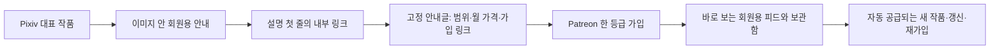

# 페티쉬 이미지 생성기 공략 전략

- 작성일: 2026-10-22
- 수정일: 2026-10-22
- 상태: 실행 전 확인
- 다음 할 일: 기존 생성 결과에 무료·회원용 분리와 이미지 안 안내를 적용할 기준을 확정하고, 계정별 단일 구독 피드에 연결한다.
- 연결 폴더: Z:\페티쉬 이미지 생성기
- 바꾼 이유: 사용자가 첫 전략을 거절했다. 페티쉬 이미지 구독 사업을 일반 일러스트·단건 판매 시험으로 바꾼 판단, 근거 없이 06을 먼저 고른 판단, 미확인 사항을 운영자의 숙제로 돌린 방식을 철회했다. 기존 14종·계정 분리·AI 생산·Pixiv 안내글 경유를 유지하고 전환·구독·반복 운영 규칙을 다시 썼다.

## 0. 공략 카드

- 주력: 기존 14종·AI 생산을 유지하고, Pixiv → 고정 안내글 → Patreon 월 구독으로 연결한다.
- 이미지: 대표 그림 안에 짧은 회원용 안내를 두고 다음 장에서 실제 제공 범위를 보여 준다. 설명 첫 줄에는 안내글 링크를 둔다.
- 상품: 계정별 월 $5 한 등급을 출발안으로 둔다. 회원용 피드와 기존 보관함을 제공한다. [가격 참고](https://support.patreon.com/hc/en-us/articles/8293538677005-Setting-Up-Your-Membership-Program)
- 가입·갱신: 지금 마음에 든 취향의 회원용 작품을 바로 보고, 같은 취향의 새 작품이 계속 들어오는 가치에 돈을 낸다는 가설이다.
- 운영: 기존 생성 결과가 작품 단위로 쌓이게 한다. 월간 작품집·개인 요청·투표·작품별 사람 승인·환영 DM은 넣지 않는다.
- 14종: 이미지에서 바로 읽히는 주제와 설정·관계가 필요한 주제는 다르게 판다. POV도 독립 취향일 수 있다. 근거 없는 06 우선순위는 철회한다.
- 돈: $5 결제는 예시 수수료 두 항목 후 $4.055다. 여기서 실제 제작·게시·환불·출금 비용을 더 뺀다. [수수료](https://support.patreon.com/hc/en-us/articles/11111747095181-Creator-fees-overview)
- 남은 조건: 실제 유료 전환·자동 게시 연결은 미검증이다. 최초 인증·거래 예외와 일부 주제의 Patreon 정책 충돌은 남는다.

## 1. 한 줄 공략

여러 무료 계정에서 자기 취향에 맞는 작품을 골라보는 이용자에게, 취향을 벗어나는 작품을 줄인 회원용 피드를 제공하고 Pixiv의 감상 흐름에서 그 차이를 보여 Patreon 월 구독으로 연결한다.

**운영자가 매번 새 상품을 궁리하는 구조는 쓰지 않는다.** 이미 있는 주제별 생성 흐름에 무료·회원용 분리와 일정한 안내 규칙을 붙인다. 다만 이 규칙을 실제 게시까지 연결하는 구현과 현재 작동 여부는 별개다.

이번 전략의 핵심 가설은 ‘그림이 더 많다’보다 **내가 좋아한 특징이 다음 작품에서도 유지돼 고르는 실패가 줄어든다**는 것이다. 자동 생성기 내부의 전문성이 돈으로 바뀌려면 구매자가 이 차이를 느껴야 한다. 기술 설명·프롬프트·제작 과정은 기본 상품에 넣지 않는다.

## 2. 정한 가정

페티쉬와 이미지 생성 기술을 이미 가진 상태에서 출발한다. 14종은 각각 별도 Pixiv·Patreon으로 운영한다는 연결 프로젝트의 결정을 유지한다. Pixiv 계정당 하루 2건 계획도 이 문서에서 임의 변경하지 않는다. 계정 통합이나 특정 주제의 폐기를 실행하지 않았다.

‘내가 일을 안 해야 한다’는 요구는 정상 생산·선별·분리·게시·안내·전달에 운영자의 판단을 반복해서 끼워 넣지 말라는 뜻으로 적용한다. 사람이 매번 승인하는데 AI 자동화라고 부르거나, 월간 묶음 14개를 만들고 확인하라고 바꾸지 않는다. 최초 본인 확인과 실제 거래 예외까지 사라졌다고 말하지는 않는다.

첫 고객 언어는 일본어, 보조 안내는 영어로 둔다. 유입처가 Pixiv이고 현재 주제 지식이 일본어 장르 표현을 많이 사용하기 때문이다. 이는 일본 고객의 결제율이 더 높다는 조사 결과가 아니다. 한국어는 운영 문서에 사용하며 한국 고객의 접근을 막지 않는다.

현재 확인한 것과 가정은 다음과 같다.

| 항목 | 사용할 전제 | 구분할 사실 |
|---|---|---|
| 생산 | 사용자가 보유한 생성 기술과 14종을 활용한다 | 실제 이미지 품질을 이번에 전수 심사하지 않았다 |
| 계정 | 14개 브랜드의 분리를 유지한다 | 실제 28개 계정의 인증·연결을 확인한 것은 아니다 |
| 자동화 | 전략은 전 과정 자동화를 목표로 정한다 | Patreon까지 실사이트 자동 게시 성공은 미확인이다 |
| 고객 | 좁은 취향을 반복해 소비하는 사람을 노린다 | 이 프로젝트의 구매·유지·정산 자료는 아직 없다 |
| 가격 | 한 등급 월 $5를 출발안으로 둔다 | 최적가·실제 적용 가격·매출 예측이 아니다 |

연결 프로젝트의 파일·설정·계정은 수정하지 않았다. 전략과 근거만 이 저장소에 썼다.

## 3. 시장

수입 경로는 `Pixiv에서 취향 발견 → 회원용의 차이 인지 → 고정 안내글 → Patreon 유료 가입 → 회원용 피드 이용 → 갱신 또는 재가입 → 수수료·환불 차감 후 정산`이다. 구경꾼 전부를 가입자로 만들려 하지 않는다.

| 수익 구조 | 이 운영자에게 생기는 일 | 선택 |
|---|---|---|
| 취향별 한 등급 구독 | 같은 생산 흐름을 계속 공급하고 작품 접근을 관리한다 | 주력이다. 제작 단위를 매번 다시 상품화하지 않는다 |
| 작품별 단건 판매 | 상품별 가격·판매 설명·권한·구매 위치가 늘 수 있다 | 이번 기본안에서 뺀다. 구독을 하기 위한 필수 시험 단계로 강제하지 않는다 |
| 월간 작품집 | 월별 기획·마감·포장·지난달 처리라는 단위가 생긴다 | 거절된 구조다. 이름만 바꿔 되살리지 않는다 |
| 요청·커뮤니티·친밀감 | 개별 기대·답변·수정·관계 유지가 생긴다 | 운영자 조건과 맞지 않아 넣지 않는다 |
| 생성기·프롬프트 판매 | 사용자 지원과 재현성이라는 다른 사업이 된다 | 이미지 감상 고객에게 기본 혜택으로 붙이지 않는다 |

Patreon은 한 등급으로 시작하는 단순한 구성을 권하고, 일반적인 신규 멤버십의 출발 가격으로 $5를 제시한다. 이를 이 프로젝트의 최적가 증거로 확대하지 않고 가격·혜택 분기를 줄이는 출발 근거로만 쓴다. [공식 멤버십 구성 안내](https://support.patreon.com/hc/en-us/articles/8293538677005-Setting-Up-Your-Membership-Program)

## 4. 개나소나 하는 것

같은 생성 도구를 가진 경쟁자가 쉽게 공급할 수 있는 것은 ‘넓은 주제의 이미지 대량 묶음’이다. 여기에 해상도·장수·VIP라는 이름을 붙여도 원하는 작품이 드물면 고객은 무료 피드로 돌아간다. 이는 현재 시장 전체의 공급 비율을 측정한 결론이 아니라 경쟁을 판단하는 기준이다.

이 프로젝트에서 피할 형태는 네 가지다.

- 공개한 한 장은 훌륭한데 회원용은 품질이 떨어지거나 취향이 다른 잔여물인 것.
- 비슷한 시드 결과를 수십 장 넣어 새 감상 가치가 있는 것처럼 보이는 것.
- 14종 전부에 긴 설정 글·같은 전개·같은 판매 설명을 강제로 적용하는 것.
- 수익이 안 나면 요청·투표·DM을 추가해 운영자 노동으로 메우는 것.

2024년 Pixiv 연구는 이미 대규모 AI 공급을 다뤘다. AI로 만들 수 있다는 사실 자체를 차별점으로 삼기 어려운 배경이며, 2026년 14종의 수익 순위 자료는 아니다. [연구 원문](https://arxiv.org/abs/2402.18463)

## 5. 고객 수요

이 사업의 고객은 그림 파일이 없어서 돈을 내는 사람이 아니다. 무료로도 많이 볼 수 있지만 자신이 좋아하는 특징에 맞는 작품을 반복해서 찾는 사람이다. 아래는 구독 이유에 대한 사업 가설이며 전체 시장에서 입증된 구매 비율은 아니다.

| 보는 사람의 상태 | 무료 감상으로 끝나는 이유 | 가입할 수 있는 이유 | 대응 |
|---|---|---|---|
| 우연히 멋진 한 장을 봄 | 그 한 장이면 충분함 | 같은 수준의 관련 작품을 지금 더 보고 싶음 | 작품 가까이에서 실제 회원용 범위를 보여 준다 |
| 특정 취향을 반복해서 찾음 | 다른 무료 계정에서도 종종 찾음 | 이 계정에서는 좋아하지 않는 표현을 덜 만나고 원하는 것을 계속 받음 | 계정별 포함·제외 기준을 일관되게 유지한다 |
| 설정과 관계를 즐김 | 설명 없는 그림은 장르 차이를 못 느낌 | 인물·설정이 이어져 감상 경험이 달라짐 | 무관한 그림 묶음 대신 구분 가능한 작품 단위로 공급한다 |
| 직접 AI를 쓰는 사람 | 직접 생성하는 것이 더 재미있음 | 시행착오·선별보다 완성된 결과를 받는 편이 나음 | 제작 기술을 설교하지 않고 결과로 비교되게 한다 |
| 이미 한 번 가입한 사람 | 보관함을 충분히 보고 저장함 | 이후 추가분도 같은 취향에 맞거나 다시 보고 싶은 새 작품이 쌓임 | 장기 유지와 간헐적 재가입을 모두 수입 경로로 본다 |

공개 토론에는 AI 작품 계정을 가끔 구독한다는 진술과 AI 영상 계정에 돈을 낸다는 진술이 있었다. 실제 결제 내역은 확인되지 않았고 영상 수요를 이미지 수요로 대체할 수 없다. 여기서 가져올 것은 **간헐적 구독도 가능한 행동이라는 약한 단서**다. [관측 진술과 한계](근거.md)

로컬 태그 DB는 46,498행이지만 수요 관련 필드가 모두 0으로 저장돼 있다. 측정 부재이며 수요 0이 아니다. 따라서 아래 14종 평가는 가짜 매출 점수가 아니라 현재 정의·감상 경험·생산 부담을 대조한 판단이다.

## 6. 시장 공략점과 첫 진입 지점, 타깃

### 14종이 먹힐지에 대한 판단

**14종을 같은 상품 구조로 팔면 일부는 주제가 제대로 전달되지 않는다.** 한 장으로 취향을 판단하는 주제는 대표작과 회원용의 일치가 핵심이고, 설정·관계가 핵심인 주제는 그 차이가 작품에서 읽혀야 한다. 아래 ‘성립’은 매출 보장이 아니라 사업 가설을 유지할 이유가 있다는 뜻이다.

| 주제 | 고객이 골라보는 차이 | 지금 구조에서 안 먹힐 지점 | 구독 상품으로 살릴 조건·판단 |
|---|---|---|---|
| 01 TS | 변화 전후의 정체성과 상황 차이 | 결과 인물 한 장만 보면 일반 캐릭터 그림과 구분하기 어렵다 | 설정이 실제 작품에서 이해되는 공급이 필요하다. 그 차이가 유지되면 독립 주제로 볼 이유가 있다. 일반 이미지 물량으로 대체하면 약하다 |
| 02 최면세뇌 | 특정 판타지 설정 | 관심이 있어도 현행 Patreon의 동의 규정과 판매 경로가 충돌한다 | 수요가 없다는 판정은 아니다. 현재 성적 설정 그대로 Patreon 구독에 연결하는 권고는 못 한다. 이 경로의 미해결 사항을 숨기지 않는다 |
| 03 하반신 | 조형·의상·구도에서의 구체적 선호 | 넓은 부위 이름만으로는 무료 대체재와 차이가 작다 | 좋아한 조형·화풍을 유지하고 원치 않는 표현을 섞지 않는 회원 피드로 성립 가능하다. 한 장의 주목도를 반복 지불로 착각하면 실패한다 |
| 04 MTF빙의 | 몸과 정체성의 불일치를 읽는 설정 | 01과 05의 그림을 재분류한 것처럼 보일 수 있다 | 다른 설정이라는 차이가 감상 과정에 나타나야 한다. 별도 계정은 유지하되 제목만 다르면 독립 상품 가치가 약하다. 동의 기준도 별도 확인한다 |
| 05 MTF교체 | 인물 간 교체라는 관계와 대비 | 단독 인물만 계속 보여 주면 교체의 차이가 사라진다 | 인물·상황의 대응을 유지하는 작품 단위가 필요하다. 생성보다 연속성의 실패가 상품을 망칠 수 있어 01·04와 다른 기준으로 선별한다 |
| 06 젠더플레이 | 신체 변화가 아닌 의상·표현·자기 모습의 변화 | 일반 캐릭터 그림으로 보이거나 01과 섞이면 고객 기대가 흐려진다 | 독립 취향으로 볼 이유가 있다. 원래 정의를 유지해야 하며 ‘운영이 쉬워 보인다’는 이유로 14종 중 매출 1순위로 고르지 않는다 |
| 07 얀데레 | 성격·관계에서 느끼는 일관된 인상 | 표정 하나만 반복하면 성격 상품이 아니라 표정 태그에 그친다 | 장르가 읽히는 관계·상황을 유지해야 한다. 매번 소설을 읽어야만 이해된다면 지금 이미지 유입 구조와 안 맞는다. 강압적 성적 표현은 별도 제한을 받는다 |
| 08 관음 | 관찰 시점과 그 상황에 대한 관심 | 현재 설정의 비인지·비동의 요소가 Patreon 규정과 충돌할 수 있다 | 다른 촬영 각도로 바꾸면 같은 수요가 유지된다고 장담할 수 없다. 현재 정의의 수요 판단과 Patreon 판매 적합성을 나눠 남긴다 |
| 09 가슴 | 조형·의상·화풍의 세부 선호 | 넓은 태그 안의 서로 다른 취향이 섞이면 내 취향인 비율이 낮아진다 | 03처럼 세부 선호의 일관성을 파는 구조가 맞다. ‘많이 만들기’보다 계정의 포함·제외 기준이 필요하다 |
| 10 레즈치녀 | 등장인물 사이의 관계와 상호작용 | 두 인물을 넣었다는 사실만으로 관계가 전달되지는 않는다 | 실제 관계 표현이 읽히고 인물·접촉 오류가 적어야 한다. 동성 관계 자체와 강압 여부를 혼동하지 않는다. 여러 인물의 품질 실패를 물량으로 덮지 않는다 |
| 11 발정 | 특정 상태·분위기의 일관성 | 다른 모든 주제에도 붙일 수 있어 채널의 내용이 무제한으로 넓어질 수 있다 | 상태 표현만이 아니라 함께 유지할 캐릭터·화풍·상황 범위를 정해야 독립 피드가 선명해진다. 의식·동의 능력 관련 조건도 지켜야 한다 |
| 12 키스 | 관계·표정·거리감에서 오는 감상 가치 | 현재 IP 코스프레 의존은 캐릭터 인기를 내 브랜드 수요처럼 보이게 한다 | 관계 표현의 상품성은 있다. 특정 IP 이용 권리는 별도이며, 이름을 지운다고 해결되지 않는다. 고객이 원작 때문에 오는지 계정의 표현 때문에 오는지 구분한다 |
| 13 POV | 일인칭 시점으로 보는 감상 경험 | 제작 옵션이라는 이유만으로 시장이 아니라고 버리거나 다른 시점까지 섞는 것 | 표현 방식도 구매 취향이 될 수 있다. 독립 계정을 유지할 이유가 있다. 다른 주제를 결합해도 일인칭이라는 약속을 지키며 중복 고객은 중복 매출로 계산하지 않는다 |
| 14 젖은옷 | 의상·소재·상황 표현의 선호 | 효과 하나를 반복하면 금방 비슷해지고 무료 한 장으로 충분해질 수 있다 | 해당 표현을 유지하면서 작품의 차이가 있어야 한다. 03·09와 조합될 수 있지만 똑같은 결과를 세 브랜드에 복제해 새 수요라고 보지 않는다 |

수익 구조를 적용하기 쉬운 갈래는 **그림 자체에서 선택 기준이 보이는 주제**다. 설정형은 감상 단위가 더 복잡하고 관계형은 인물 간 일관성이 중요하다. 이 차이를 반영해 생산·선별·설명 규칙을 달리한다. 판매 데이터 없이 임의로 06부터 열라는 순위는 철회한다.

14개 계정은 서로 다른 취향을 모으는 가게다. 공통 운영 방식은 재사용하되, 한 계정의 회원이 좋아한 세부 특징을 다른 13곳에도 일괄 적용하지 않는다. 작은 수입의 합산은 유효하지만 14개의 매출과 사람 손이 모두 같은 비율로 늘어나는 것은 아니다.

### 좁힐 것은 매번 만드는 상품이 아니라 계정의 약속이다

각 주제에서 고정할 것은 `좋아하는 핵심 특징 / 섞지 않을 인접 표현 / 유지할 화풍 범위 / 이해에 필요한 정보`다. 바꿀 것은 그 안의 캐릭터·장소·의상·구성 등이다. 이 기준은 기존 주제 지식에서 정하고 매일 새로 기획하지 않는다. 고객이 좋아한 특징까지 무작위로 바꾸면 같은 태그여도 다른 상품이 된다.

## 7. 그 고객이 마음에 쏙 들 공략

### Patreon에서 파는 것은 회원용 피드 하나다

각 계정에 **월 $5 한 등급**을 둔다. 가입하면 해당 계정의 회원용 작품과 기존 보관함을 볼 수 있고, 실제 추가되는 작품도 같은 등급에서 받는다. 월간 작품집, VIP 단계, 요청권, 투표권, 친목, 제작 강좌, 프롬프트, 별도 영상은 기본 혜택에서 뺀다. 계정 간 합동 이용권도 만들지 않는다.

생산 단위는 달력이 아니라 기존 생성 흐름에서 완성된 작품 단위다. 자동으로 생성·선별된 결과를 그대로 회원용 게시에 연결한다. 운영자가 매달 제목을 정하고 작품집을 편집·승인하는 단계를 만들지 않는다. ‘수시 갱신’이라는 문구로 실제로 멈춘 공급을 숨기지도 않는다.

### 무료와 유료를 이렇게 나눈다

| 구분 | 제공할 것 | 금지할 방식 |
|---|---|---|
| Pixiv 공개 | 혼자 보아도 가치가 있는 대표 작품, 회원용과 어떤 관계인지 알 수 있는 안내 | 가장 좋은 한 장만 공개하고 유료에 불량·무관한 결과를 몰아넣기 |
| 회원용 | 대표 작품에서 좋아한 특징이 유지되는 다른 완성 작품, 해당 계정의 기존 보관함 | 같은 그림의 해상도만 바꾸거나 비슷한 결과를 장수로 부풀리기 |
| 안내용 비교 | 실제 회원용의 구성·범위가 있다는 근거 | 존재하지 않는 후속분·거짓 수량·유료 전용을 가장한 공개분 |

**회원용의 차이는 ‘수위가 높다’ 하나로 잡지 않는다.** 취향 일치·작품 간 의미 있는 차이·선별 품질이 없으면 더 강한 표현이나 더 많은 장수도 지속 구매 이유를 대신하지 못한다. 이 문서는 성적 장면이나 자극을 강화하는 제작 지침을 작성하지 않는다.

공개 비율은 무조건 20% 같은 숫자로 정하지 않는다. 하나의 감상 단위를 무료로 온전히 보여 주되, 회원용에서 받을 실제 추가 가치가 남아 있어야 한다. 공개 작품만 반복해서 보아도 회원용의 대부분을 결국 받는다면 기다리면 되는 구조가 된다. 따라서 회원용으로 약속한 범위와 나중에 공개할 범위를 생성 결과를 배분할 때 구분한다.

### 가입 직후에는 기다리거나 문의하지 않게 한다

Patreon 상단 소개에는 취향 범위·월 가격·지금 열리는 범위만 남긴다. 게시물은 Pixiv와 같은 작품 식별자를 쓴다. Welcome note에는 첫 작품이나 보관함으로 가는 경로를 넣고, Collection에는 작품을 정해진 순서로 쌓는다. 별도 Google Drive 권한·월별 비밀번호·수동 DM 발송을 만들지 않는다.

Welcome note는 가입 직후 표시되고 확인 이메일에도 포함된다. Collection은 분류 기능이며 유료 권한은 게시물에서 정한다. 이 기능들이 자동 게시 API를 보장하는 것은 아니다. [Welcome notes](https://support.patreon.com/hc/en-us/articles/360038514972-Make-custom-welcome-notes), [Collections](https://support.patreon.com/hc/en-us/articles/16666733679757-How-to-use-Collections-to-organize-your-work)

### 다음 달에 남는 이유

가입 이유는 지금 볼 수 있는 작품이고 갱신 이유는 앞으로도 좋아할 작품이 실제로 들어오는 경험이다. 보관함 장수만으로 유지시키려 하지 않는다. 새로운 작품은 계정의 핵심 취향을 유지하면서 달라야 하며, 기존 생산 흐름이 이를 공급한다. 갱신을 위해 특별 이벤트나 운영자의 인사를 추가하지 않는다.

모두가 매달 남는 모델을 가정하지 않는다. 한 번 보고 나갔다가 추가분이 쌓이면 다시 들어오는 고객도 있다. 그런 고객을 막으려고 과거 파일을 월별로 잠그거나 해지를 어렵게 하지 않는다. 실제 갱신·재가입·순수령으로 계산한다.

## 8. 적은 돈과 손으로 찾아오게 하는 법

### 그림만 보고 떠나는 사람에게는 그림을 보는 동안 알린다

긴 설명을 읽게 하는 것이 아니라, **이미지를 감상하는 동안 회원용의 존재와 차이를 알아보고 설명 첫 줄의 링크를 찾게 한다.** 배치는 아래처럼 고정한다. 장문의 성적 홍보 문구나 매번 다른 카피가 필요하지 않다.

| 위치 | 고정 역할 | 자동으로 채울 것 |
|---|---|---|
| 첫 이미지 | 작품이 중심이다. 가장자리의 작은 안내에 회원용이 있음을 알린다 | 작품 또는 시리즈 식별자, 안내 방향 |
| 두 번째 이미지 | 실제 회원용 범위의 대표 예시나 간단한 구성 안내를 보여 준다 | 공개 가능한 기존 이미지, 실제 구성 정보 |
| 설명 첫 줄 | 고정 안내글로 이동하는 링크를 둔다 | 계정별 안내글 주소 |
| 설명 나머지 | 주제를 이해하는 데 필요한 최소 배경만 둔다 | 작품의 짧은 설명과 정확한 태그 |

안내 문구의 역할을 보여 주는 일반 예시는 `회원용 같은 시리즈 · 가입 안내는 작품 설명에`다. 첫 줄은 `회원용 작품과 월 구독 안내 → [이 계정의 고정 안내글]`처럼 목적지를 밝힌다. 이 표현을 실제 UI의 버튼처럼 그리거나 이미지 속 주소가 클릭된다고 가정하지 않는다. 눈에 안 띄는 워터마크 수준으로 숨기지도, 큰 광고판으로 작품을 가리지도 않는다. 실제 앱·화면 크기에서의 배치 확인은 남는다.

두 번째 장을 무조건 광고장으로 복제하지 않는다. 회원용 범위를 증명할 실제 정보가 있을 때만 쓴다. 반복되는 빈 홍보 이미지를 작품 수로 부풀리지 않는다. 첫 이미지에도 안내가 있어야 끝까지 넘기지 않은 사람에게 닿는다. 설명을 전혀 열지 않는 사람까지 모두 움직일 방법은 없다.

### Pixiv 안내글 하나를 유지한다

사용자가 고른 경로를 기본으로 둔다. **계정별 Pixiv 고정 안내글 하나**에 다음 네 가지를 순서대로 넣는다.

1. 어떤 취향의 회원 피드인지.
2. 가입하면 지금 무엇을 볼 수 있는지와 공개분과의 차이.
3. 월 $5 한 등급이며 자동 갱신되는 구독이라는 점.
4. 해당 Patreon으로 가는 링크 하나.

작가 소개·설정 소설·다른 13개 계정·작품별 긴 목차는 넣지 않는다. 고정 안내글에 매일 바뀌는 작품 수·다음 발행일을 박아 유지 일을 만들지 않는다. 현재 작품 목록은 실제로 갱신되는 Patreon 피드가 맡는다. 가격·혜택이 바뀔 때만 공통 안내를 고친다.

**이 동선은 채널 가입을 설득하는 경로다.** 고정 안내글 하나가 모든 과거 작품의 유료 게시물로 각각 바로 연결되는 것처럼 약속하지 않는다. 특정 작품을 바로 받으려는 고객에게는 중간 탐색 비용이 남는다. 실제로 그 비용이 전환을 해친다는 관측이 있을 때, 허용되는 위치의 작품별 직접 연결을 보조로 비교한다. 처음부터 사용자의 고정 안내글 구상을 버리지 않는다.

내부 링크의 장점은 안내를 한곳에서 관리하는 것이다. 정책상 안전이 보장된다는 근거는 확인되지 않았다. Pixiv의 상업적 유도·홍보 과다 기준은 별도로 적용된다. 링크 제한을 숨기거나 회피하는 설계는 쓰지 않는다. [약관](https://policies.pixiv.net/), [검색 기준](https://www.pixiv.help/hc/en-us/articles/56357843452313-What-are-works-that-are-likely-to-violate-the-Guidelines-in-work-search)

Android 앱은 일부 계정의 프로필·캡션 링크 표시·작동이 제한될 수 있다. 웹에서 된다는 사실로 전체 경로가 검증됐다고 하지 않는다. [공식 링크 안내](https://www.pixiv.help/hc/en-us/articles/45853006255897-Links-in-profiles-and-captions-may-not-work-Android-app)

### 반복 홍보는 기존 공개 작품이 맡는다

정확한 주제·표시·제목으로 기존 Pixiv 발견 경로에 들어가고, 과거 공개 작품도 같은 안내글을 가리키게 한다. 게시할 때마다 별도 판매 글을 쓰거나 댓글·DM 영업을 하지 않는다. 오래된 공개 작품에서도 현재 가입 안내로 갈 수 있는 것이 고정 안내글의 이점이다. 첫 노출이나 검색 순위가 보장되는 것은 아니다.

## 9. 계속 만드는 규칙

정상 운영의 생산 규칙은 `계정의 취향 기준 → 기존 생성 → 자동 선별 → 회원용 범위 확정 → 회원용 게시 확인 → 공개 작품과 안내 출고`다. 이는 전략상의 요구 조건이며 이번에 실행한 프로그램이 아니다.

회원용에 실제로 없는 작품을 공개에서 먼저 약속하지 않도록 순서를 정한다. 필요한 작업을 운영자에게 넘기기보다 실패한 단위를 제외하는 방향으로 설계한다.

| 항목 | 사람이 매번 하지 않을 일 | 계속 같은 규칙으로 처리할 일 |
|---|---|---|
| 주제 | 오늘 팔릴 것을 매일 기획하기 | 기존 주제의 포함·제외 범위 안에서 새로운 조합을 고르기 |
| 선별 | 모든 이미지를 승인·수선하기 | 형식·중복·시각 일관성·내용 기준의 통과 여부를 판정하고 불확실한 결과를 격리하기 |
| 무료·회원용 분리 | 마음에 드는 파일을 손으로 골라 포장하기 | 공개본과 회원용의 품질·취향 일치 및 의미 있는 차이를 확인하기 |
| 안내 | 매 게시물마다 카피·수량·링크를 작성하기 | 확정된 파일·계정 기록에서 동일 양식을 채우기 |
| 발행 | 계정 28개를 열어 매일 클릭하기 | 계정·권한·게시 결과를 확인하는 출고 연결을 만들기 |
| 가입 | 환영 DM·파일 링크를 한 명씩 보내기 | 플랫폼의 가입 안내와 게시물 접근 기능 이용하기 |
| 실패 | AI가 못 한 모든 것을 운영자가 처리하기 | 같은 원인의 실패를 묶고 해당 작업을 정지·격리하기 |

시각 판정은 모델 이름만으로 신뢰하지 않는다. 이 프로젝트의 실제 실패 사례로 판정 기준을 검증해야 한다. 그러나 그 검증이 안 됐다는 이유로 매일 모든 파일을 사람이 승인하는 운영을 최종안으로 내지도 않는다. 반복적으로 사람이 필요한 유형은 생산 범위·판정·출고 규칙을 고칠 대상이다.

사람에게 올릴 것은 돈·계정 접근·권리 문제처럼 자동 해결 범위를 벗어나는 예외다. 단순 생성 실패와 버려도 되는 파일을 모두 알림으로 보내지 않는다. 동일 오류가 수백 건 발생해도 원인별 하나로 모아야 한다. 일상 점검용으로 14개 대시보드를 매일 보게 하지 않는다.

공개 Patreon API에서 일반 이미지 게시·상품 생성의 정식 엔드포인트는 확인하지 못했다. 자동화의 난점은 숨기지 않되 판매 구조를 단건으로 바꿔 해결한 척하지 않는다. 일반 게시까지의 연결은 구현할 과제다. [API 문서](https://docs.patreon.com/)

Pixiv 공식 예약은 동시 10작품·최대 1주일 앞이다. 계정당 하루 2건이면 5일분이다. 사용자의 자동 업로드가 필요한 이유이며 사람이 5일마다 들어가 채우는 것을 최종안으로 삼지 않는다. [예약 기능](https://www.pixiv.help/hc/en-us/articles/115003430413-I-want-to-schedule-the-date-and-time-of-my-posts)

## 10. 돈이 남고 오래 버는 법

### 시작 가격과 계정별 계산

출발안은 각 Patreon **월 $5 한 등급**이다. 기존 유료 고객이 있다면 임의로 가격이나 혜택을 바꾸지 않는다. 초기에는 14개마다 가격·혜택을 따로 설계하지 않아 관리 분기를 줄인다. 판매 자료가 생겼을 때 계정별 수요를 보고 바꾼다.

신규 표준 요금 10%, USD 카드 처리비 2.9% + $0.30, 세금 없는 웹 결제를 가정하면 결제 1건에서 두 수수료 후 $4.055다. 미국 외 PayPal 처리비 3.9% + $0.30 조건에서는 $4.005다. 환전·출금·환불·제작비·세금은 더 빠진다. 실제 계정의 기존 요금제 여부는 미확인이다. [공식 수수료](https://support.patreon.com/hc/en-us/articles/11111747095181-Creator-fees-overview)

| 월 실제 $5 결제 건수 | 매출 | 카드 결제 두 수수료 후 |
|---|---:|---:|
| 2건 | $10 | $8.11 |
| 10건 | $50 | $40.55 |
| 28건 — 14계정에 각 2건이라는 가정 | $140 | $113.54 |

이는 예측이 아니다. 작은 매출도 사람 손이 거의 없으면 유효하지만 계정마다 별도 고정비가 붙으면 남는 돈이 작아진다. 계정 14개를 열었다는 사실로 같은 고객의 지갑이 14배가 되지는 않는다.

`월 운영 잔액 = 실제 결제액 − 플랫폼·결제·출금·환전 비용 − 환불·취소 − 생성·판정·저장·게시 비용 − 추가 고정비`로 본다. 세금과 운영자 노동을 뺐는지도 표시한다. NovelAI·장비 등 이미 내는 비용과 확장 때문에 늘어나는 비용은 구분한다.

계정별 월 추가 비용을 F, 결제당 추가 비용을 v라 두면 카드 예시의 비용 회수 결제 건수는 `ceil(F / (4.055 − v))`다. 분모가 0 이하면 물량을 늘리는 것으로 해결하지 않는다. 실제 F·v는 미측정이며 0으로 넣어 수익을 꾸미지 않는다.

### 반복 결제와 이탈을 함께 본다

구독은 해지를 없애는 장치가 아니다. 월말 유료 이용자는 `기존 이용자 + 신규 가입 + 재가입 − 종료`로 변한다. 같은 기간의 실제 결제·환불을 함께 봐야 한다. 신규 가입이 있어도 기존 고객의 종료가 빠르면 수입은 쌓이지 않는다. 반대로 간헐적 재가입이 실제 수입을 만들면 그 행동을 실패로 취급하지 않는다.

무료 공개는 새 이용자를 데려오고, 회원용의 일관된 추가분은 갱신·재가입 이유를 만든다. 공개량만 늘려 신규 유입에 매달 의존하거나, 갱신을 위해 개인 요청을 받는 구조는 피한다.

한국은 Patreon의 지급 지원 목록에 포함되지만 실제 인증·은행·통화 조건은 계정에서 충족해야 한다. 계정별 잔액을 합쳐 출금할 수 있다고 가정하지 않는다. [지급 국가 안내](https://support.patreon.com/hc/en-us/articles/29467737603981-Paypal-supported-countries)

## 11. 조심할 점

정책은 이 전략의 경로를 바꾸는 조건으로만 다룬다. 제작 기술을 다시 증명하라는 일반 숙제나 시장 전체를 일반 그림 사업으로 바꾸는 이유로 사용하지 않는다.

- **Pixiv:** AI 표시·정확한 설정·홍보 과다·복수 계정 조건이 적용된다. 하루 2건이나 내부 링크가 안전선은 아니다. [약관](https://policies.pixiv.net/), [현행 가이드라인](https://www.pixiv.net/terms/?page=guideline)
- **Patreon 콘텐츠:** 일러스트형 AI의 허용과 내용의 허용은 별개다. 동의·연령·권리 조건은 유지하며 02·08의 현재 설정은 특히 충돌한다. 04·07·10·11의 개별 표현도 장르 이름만으로 통과시키지 않는다. [AI 안내](https://support.patreon.com/hc/en-us/articles/34055590411789-Understanding-Patreon-s-AI-policies-for-Adult-18-creators), [콘텐츠 기준](https://www.patreon.com/policy/guidelines)
- **공개 미리보기:** Pixiv와 Patreon 각각의 공개 기준에 맞는 부분만 사용한다. 성인 Patreon의 맞춤 썸네일·흐림 해제 제한이 있어 공개 화면에 항상 선명한 표지가 나온다고 가정하지 않는다. [이미지 기능](https://support.patreon.com/hc/en-us/articles/360038247591-Posting-images)
- **신원:** 얼굴·실명으로 팬을 모을 필요는 없지만 비공개 본인 확인은 남는다. 새 성인 계정으로 인증이 이전되지 않는 조건도 있다. [인증 안내](https://support.patreon.com/hc/en-us/articles/8335062384141-Age-Verification-Frequently-Asked-Questions-FAQ)

허용되지 않는 내용을 다른 이름으로 팔거나 안내글에 숨기는 방법은 쓰지 않는다. 02·08을 다른 표현으로 바꾸면 같은 고객이 유지된다고 장담할 수도 없다. 해당 경로는 해결된 척하지 않고 미해결로 남긴다. 대체 판매처도 원문·결제·유입 확인 없이 붙이지 않는다. FANBOX는 주요 과정에 AI를 사용한 콘텐츠 배포를 제한하므로 자동 대안이 아니다. [FANBOX 안내](https://fanbox.pixiv.help/hc/ja/articles/20299395982489)

판매·게시가 멈췄을 때 같은 안내로 신규 가입을 계속 받는 것은 피해야 한다. 기존 접근 유지와 실제 거래 처리를 우선하고, 계정 경고를 무한 재시도로 키우지 않는다. 국내 법률·세무·개별 권리 상태까지 이번 문서로 확정한 것은 아니다.

## 12. 보면서 고칠 것

### 전략은 정했고, 관측은 틀린 부분을 고치는 데 쓴다

이번 권고는 단일 구독 피드와 고정 안내글 경로다. 가입 시험을 먼저 통과해야 비로소 전략을 생각하겠다는 순서로 두지 않는다. 기존 생산 결과로 이미지 안내·무료/회원용 분리·가입 후 접근을 연결하고, 아래 행동을 확인한다. 새 광고·새 유료 도구·별도 상품 제작부터 시작하지 않는다.

| 관측 | 우선 의심할 것 | 고칠 것 |
|---|---|---|
| 작품은 보지만 안내글 이동이 약함 | 회원용 존재나 차이가 눈에 안 들어옴 | 이미지 안 안내와 실제 회원용 범위 제시를 고친다. 소설을 늘리지 않는다 |
| 안내글 도착 후 Patreon 이동이 약함 | 제공 범위·가격이 불분명하거나 이동이 안 됨 | 안내글 첫 부분과 실제 링크 작동을 고친다 |
| Patreon 방문 후 유료 가입이 약함 | 무료 대비 가치·취향 일치·결제 이해가 부족함 | 회원용과 공개본의 관계 및 가입 직후 열리는 내용을 고친다. 요청 혜택을 덧붙이지 않는다 |
| 가입 후 바로 이탈·환불 | 미리보기와 실물이 다르거나 접근이 불편함 | 내용 일치·권한·첫 접근 경로를 고친다 |
| 첫 달 이용 후 종료가 많음 | 현재 보관함만으로 만족하거나 추가분 가치가 약함 | 새 작품의 차이·취향 유지와 재가입을 본다. 과거 파일을 억지로 잠그지 않는다 |
| 회원이 늘수록 문의가 늘음 | 상품·권한·안내가 복잡함 | 질문의 원인을 없앤다. AI 답변 수를 성과로 보지 않는다 |
| 생성·게시 실패가 사람을 계속 부름 | 정상 공정이 사람에게 의존함 | 같은 원인의 격리·중지·재사용 가능한 복구 기준을 고친다 |

Patreon의 방문·방문자·유료 가입·실제 결제는 구분한다. Pixiv 안내글 조회를 링크 클릭 수라고 바꾸지 않는다. 스크롤 깊이나 특정 작품에서 결제까지의 귀속이 제공되지 않으면 측정했다고 쓰지 않는다. [통계 안내](https://support.patreon.com/hc/en-us/articles/207346316-Insights-dashboards)

이미지 안 안내 유무를 비교할 때는 같은 계정의 비슷한 작품 조건으로 나누고 가격·태그·시간·혜택을 한꺼번에 바꾸지 않는다. 같은 그림의 중복 게시 시험은 하지 않는다. 안내글은 유지한 채 한 요소씩 바꿔야 무엇이 영향을 줬는지 판단하기 쉽다. 노출이 거의 없으면 전환 실패라고 판정하지 않는다.

첫 번째 관측은 실제 도착·유료 가입이고, 두 번째는 결제 갱신 시점 이후의 유지·재가입이다. 특정 날짜 안 팔렸다고 탈락시키지 않는다. 관측 기준과 표본 계산은 [근거](근거.md)의 구분을 따른다. 이를 운영자에게 매일 수작업 보고하라는 뜻으로 쓰지 않는다.

### 운영자가 2주 동안 보지 않아도 되는가

기존 일정대로면 14계정·하루 2건·14일은 392게시다. 모든 게시물의 사람 승인 없이 생성·선별·회원용 게시·공개본 게시·안내가 이어져야 한다. 재고 부족·계정 연결 오류·결과 불명확 상태에서 잘못된 약속을 계속 내보내지 않아야 한다. 이것이 이 전략의 자동화 요구다.

미완성 자동화의 빈자리를 운영자 노동으로 메우는 안은 합격으로 보지 않는다. 다만 인증·결제 분쟁 같은 예외까지 영원히 0건이라고 보장할 수는 없다. 실제 부재 시험·판매 시험은 이번 대화에서 실행하지 않았다.

## 13. 같은 자산으로 넓힐 시장

| 순서 | 넓힐 대상 | 재사용할 자산 | 늘어나는 일과 조건 |
|---|---|---|---|
| 1 | 같은 브랜드 안의 새로운 작품 | 취향 기준·화풍·선별·게시·안내 | 다른 작품으로 느껴지는지와 추가 제작비를 본다. 새 상품 기획을 매번 하지 않는다 |
| 2 | 기존 14종의 다른 브랜드 | 공통 계정 운영·유료 등급·오류 처리·안내 형식 | 주제별 취향 기준·회원용 가치·계정 비용은 별도다. 같은 콘텐츠의 복사로 수입원을 늘렸다고 하지 않는다 |
| 3 | 같은 작품을 찾는 다른 언어 이용자 | 원본·분류·일반 안내 | 제목·안내의 이해와 해당 유입 경로를 확인한다. 그림 제작을 새로 하지 않는 확장부터 본다 |
| 4 | 다른 판매처 | 허용된 원본·품질 기록·고객 이해 | 정책·정산·신규 유입·지원 부담을 확인한 뒤다. 이름만 나열해 당장 늘리지 않는다 |

구독자가 적어도 추가 수고·비용이 거의 없다면 작은 수입을 유지할 수 있다. 저매출이라는 이유만으로 없애지 않는다. 반대로 두 계정이 같은 고객을 나눠 갖고 인증·정산·게시 예외만 늘리면 총매출이 증가했는지 따져야 한다. 운영자의 계정 분리 결정은 실제 변경 요청 없이 뒤집지 않는다.

## 14. 다음에 발굴할 시장

새 플랫폼부터 찾기보다 현재 고객이 무엇 때문에 원하는 작품을 못 찾는지 본다.

| 신호 | 다음 가설 | 재사용과 확인 |
|---|---|---|
| 특정 화풍·표현 조합만 반복 선택함 | 넓은 주제 안의 세부 취향 피드 | 기존 생성·선별 기준을 더 정확히 쓰면 되는지, 별도 계정이 정말 필요한지 본다 |
| 작품을 못 찾는 문제가 반복됨 | 감상 방식에 맞는 분류·탐색 | 새 콘텐츠 제작보다 기존 작품 접근 개선이 유지에 도움이 되는지 본다 |
| 한 번 나갔다가 새 작품이 쌓이면 돌아옴 | 간헐적 재가입 고객층 | 계속 붙잡는 혜택 대신 공개 작품을 통한 재발견이 작동하는지 본다 |

별도 고객지원 사업·생성기 판매·개인 주문으로 넓히는 것은 지금의 저노동 이미지 구독과 다른 사업이다. 새 기회라는 이유만으로 현재 운영자의 부담을 늘리지 않는다.

## 15. 반론과 확인할 전제

### 첫 전략을 왜 버렸는가

첫 전략은 질문에 대한 해법 대신 안전한 쪽으로 범위를 바꿨다. 일반 일러스트를 먼저 팔라거나 단건 판매를 통과하라는 요구는 사용자가 정한 사업의 다음 단계가 아니었다. ‘미검증’은 사실 구분에 필요하지만 구매 장치·구독 상품·운영 규칙을 내지 않은 것을 정당화하지 못한다. 06의 우선순위와 단건 판매 주력 권고를 철회한다.

### 게으르고 책임지기 싫은 운영자의 입장에서 다시 깨기

| 반론 | 그대로 두면 생기는 실패 | 이번에 바꾼 것·남은 한계 |
|---|---|---|
| “같은 취향 그림 더 준다는 뻔한 소리잖아.” | 추가분이 실제로도 무작위면 돈 낼 이유가 약하다 | 좋아한 특징의 유지·싫어할 인접 표현의 제외·실제 회원용 범위를 생산과 안내에 연결했다. 그래도 구매 여부는 실적으로 확인해야 한다 |
| “이미지에 글 넣으면 사람들이 싫어하지 않아?” | 감상을 해치는 광고판이 될 수 있다 | 짧은 안내만 고정하고 작품을 가리지 않는다. 실제 반응이 나쁘면 위치·크기를 바꾸며 긴 홍보 이미지로 늘리지 않는다 |
| “밑까지 안 내리는 건 그대로잖아.” | 끝까지 읽게 하는 전략은 실패한다 | 이미지 안에서 존재와 차이를 먼저 알리고 설명 첫 줄만 찾게 한다. 모든 사람을 움직인다는 주장은 하지 않는다 |
| “고정글 한 개로 왜 바로 그 작품을 못 찾아?” | 고정 주소는 작품별 목적지를 자동으로 기억하지 않는다 | 채널 가입 경로라는 약속을 명확히 했다. 특정 작품 직행이 필요한 수요가 크면 허용된 직접 경로를 보조로 검토한다 |
| “매번 유료분을 내가 고르는 거야?” | 선별이 사람에게 돌아와 무인 운영이 깨진다 | 기존 취향·품질 기준으로 자동 분리한다. 판정 실패는 제외하고 운영자에게 전량 승인시키지 않는다 |
| “월간 작품집이랑 이름만 다른 거 아냐?” | 월말 기획·편집·검수 의무가 그대로 남는다 | 달력 단위 상품을 없앴다. 기존 생성 결과가 작품 단위로 회원 피드에 쌓이며 월말 포장 작업이 없다 |
| “그래도 계속 생산해야 하잖아.” | 구독이 유지되려면 추가 가치가 필요하다 | 이미 하기로 한 자동 생산을 구독에 연결한다. 별도 유료용 연재·이벤트·요청을 만들지 않는다. 생산까지 완전히 멈춰도 계속 돈 낸다는 주장은 버린다 |
| “전부 받고 한 달 만에 나가면?” | 보관함이 일회성 가치에 그칠 수 있다 | 새 작품의 가치와 간헐적 재가입까지 수익으로 본다. 해지 방해·파일 잠금·수작업 보상으로 해결하지 않는다 |
| “14개 구독을 누가 다 해?” | 같은 지갑을 14번 매출로 계산한다 | 계정별 다른 취향 고객을 겨냥한다. 전 계정 묶음 가입이나 합동 이용권을 기본으로 하지 않는다 |
| “POV는 그냥 옵션이라면서 왜 계정을 만들었겠어?” | 제작 분류를 고객의 선택 기준과 혼동한다 | 표현 방식도 독립 취향이 될 수 있다고 바로잡았다. 시점의 일관성이 실제 상품 약속이다 |
| “14종 진짜 팔린다는 근거가 없네.” | 설계 판단을 매출 예측으로 포장한다 | 주제별 성립 이유와 깨지는 조건을 냈다. 없는 매출 순위는 만들지 않지만 판단을 전부 보류하지도 않는다 |
| “AI가 다 하는데 왜 시간 계산으로 겁줘?” | 가상의 수작업 시간을 필수 노동처럼 오해시킨다 | 수작업을 정상 공정에서 제거하는 조건을 먼저 썼다. 시간 계산은 숨어 있는 의존을 찾는 보조 지표로만 둔다 |
| “예외 알림만 하루 수십 개면 똑같이 일이잖아.” | 실패 처리 업무가 새로운 직업이 된다 | 버려도 되는 결과는 자동 제외하고 반복 오류는 원인별로 묶는다. 같은 실패가 매번 사람을 부르면 구조를 고친다 |
| “링크가 내부면 안전한 거 아니야?” | 확인되지 않은 정책 전제로 전 계정을 운영한다 | 관리 편의는 살리되 안전 보장은 하지 않는다. 규칙은 근거 문서에 짧게 분리한다 |
| “이렇게 해도 아무도 안 사면?” | 부담만 없고 고객 가치가 없는 상품일 수 있다 | 무료 감상·이동·가입·유지 중 어디가 끊기는지에 따라 상품·안내를 고친다. 운영자의 친절·노동을 더 넣는 해법으로 도망가지 않는다 |

이 안도 판매 성공을 보장하지 않는다. 특히 **원하는 취향을 꾸준히 맞추는 것이 현재 생성기에서 실제로 가능한지**, 회원용 차이를 본 사람이 돈을 내는지, 자동 게시까지 연결되는지는 남아 있다. 그러나 남은 사실을 확인할 때까지 전략을 미루는 대신 실행할 상품·동선·반복 규칙은 위와 같이 정했다.

## 16. 출처

공식 원문 확인일은 2026-10-22다. 같은 작업에서 이미 직접 확인한 정책·기능·수수료는 재사용했고, 이번 수정에서는 멤버십 구성·Collections·Welcome notes 원문을 추가로 열었다. 게시·개정일과 적용 범위는 [근거.md](근거.md)에 기록했다.

14종 분석의 원자료는 연결 프로젝트의 주제 설정과 제작 지식이다. 이는 제작 의도이며 매출 데이터가 아니다. 공개 구독 자기 진술 두 건은 [관측 자료](원자료-2026-10-22.csv)에 따로 남겼고, 실제 구매 원장이나 대표 표본으로 쓰지 않았다. 사용자 파일·계정의 비밀이나 개인 이름·연락처는 수집하지 않았다.
