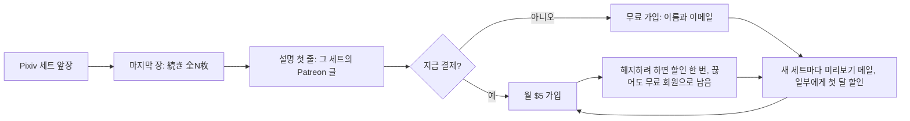

# 페티쉬 이미지 생성기 공략 전략

- 작성일: 2026-10-22
- 수정일: 2026-10-23
- 상태: 실행 전 확인
- 다음 할 일: 생성기에 세트 생성과 Patreon 자동 게시를 붙이고, 12개 Patreon 페이지의 무료 가입 버튼을 앞으로 옮긴다.
- 연결 폴더: Z:\페티쉬 이미지 생성기
- 바꾼 이유: 두 번째 전략도 거절됐다. 운영자가 원하는 것을 2번 첫머리에 먼저 정의하고, 막힌 곳인 'Pixiv에서 보고 끝나는 문제'를 장치 하나로 풀었다. 결제 대신 무료 가입을 받고 판매는 Patreon 자동 기능에 맡긴다. 파는 것은 '같은 취향 더'가 아니라 '방금 본 세트의 나머지'다. 고정 안내글을 빼고 작품마다 그 세트의 Patreon 글로 바로 보낸다. 02와 08은 Patreon이 금지하는 내용이라 연결하지 않는다.

## 0. 공략 카드

- 한 줄: Pixiv 이용자에게 결제를 조르지 않고 Patreon 무료 가입 한 번만 받는다. 그 뒤 판매는 Patreon이 자동으로 한다.
- 파는 것: 방금 Pixiv에서 본 그 세트의 나머지 장과 지금까지 올린 모든 세트. 계정마다 월 $5 한 등급이다.
- Pixiv 게시: 세트 앞 몇 장만 올린다. 마지막 장에는 나머지 장의 흐린 축소판과 '続き 全N枚'를 넣는다. 설명 첫 줄은 그 세트의 Patreon 글 주소다.
- Patreon 글: 잠긴 그림 앞의 공개 칸에 노출 없는 표지와 600자 넘는 설정 소개를 둔다. 그래야 무료 회원에게 새 세트 미리보기 메일이 바로 간다.
- Patreon 자동 판매: 미리보기 메일, 가입할 만한 무료 회원에게 첫 달 할인, 결제하다 만 사람 알림, 해지 직전 할인이 기본으로 켜져 있다.
- 무료 체험: 처음엔 끈다. 7일 동안 '세트의 나머지'를 공짜로 다 보고 나갈 수 있어서다.
- 고정 안내글: 뺀다. 한 단계가 늘고 본 작품을 못 찾는다. 프로필에 링크 한 줄만 둔다.
- 만들 것: 생성기에 세트 생성, 마지막 장 자동 제작, 공개 칸 소개글 작성, 동의 검사, Patreon 자동 게시를 붙인다. 그 뒤 반복할 일은 없다.
- 주제: 12개 계정에 같은 장치를 한꺼번에 건다. 02 최면과 08 관음은 Patreon이 금지해 Pixiv만 운영한다.
- 돈: $5 카드 결제 한 건에서 수수료를 빼면 $4.055가 남는다. 등급 설명에 개수나 일정을 약속하지 않아 납품 의무가 없다.
- 첫 확인: 2주 뒤 Patreon 통계에서 무료 회원 수와 유료 회원 수를 보고 막힌 칸 하나를 고친다.
- 가장 큰 위험: Pixiv 약관은 성인 사이트로 보내는 글을 금지한다. 고정 안내글이든 작품별 링크든 Pixiv에서 Patreon으로 보내는 길에는 계정 제재 위험이 있다.

## 1. 한 줄 공략

Pixiv에서 특정 취향 그림을 넘겨 보다 멈춘 사람에게 그 세트의 나머지가 Patreon에 있다는 것을 그림 안에서 보여 준다. 결제 대신 무료 가입 한 번으로 붙잡고, 그 뒤 미리보기 메일과 할인으로 Patreon이 월 구독으로 바꾼다.

지금까지의 안은 Pixiv에서 본 순간에 돈을 내게 하려 했다. 그 순간은 짧고 사람들은 설명을 안 내린다. 이 안은 그 순간에 연락할 수 있는 상태만 만든다. 파는 일은 사람이 아니라 Patreon이 매일 한다.

## 2. 정한 가정

### 운영자가 원하는 것

| 항목 | 운영자가 원하는 것 | 운영자가 한 말 |
|---|---|---|
| 원하는 결과 | 이미 만든 AI 페티쉬 이미지 생성기로 매달 구독료가 들어온다 | 첫 전략을 단건 판매와 일반 그림 시험으로 바꿨다는 이유로 거절 |
| 그대로 둘 것 | 14종, 주제마다 Pixiv와 Patreon 계정 하나씩, Pixiv 하루 2건, AI 자동 생성과 자동 게시 | 계정 운영 명세에 확정 |
| 막힌 곳 | Pixiv에서 그림만 보고 떠난다. 설명을 안 내리고, 링크를 눌러도 본 작품을 못 찾는다 | "밑까지 안 내리는 건 그대로잖아", "왜 바로 그 작품을 못 찾아?" |
| 돈 낼 이유 | '같은 취향 그림 더'보다 확실한 이유 | "뻔한 소리잖아", "아무도 안 사면?" |
| 운영자 일 | 2주 비워도 생성, 게시, 가입, 결제가 돈다. 유료분을 손으로 고르지 않는다 | "매번 유료분을 내가 고르는 거야?", "예외 알림만 하루 수십 개면 똑같이 일이잖아" |
| 책임 | 구독자에게 개수, 마감, 요청, 답장을 약속하지 않는다 | 월간 작품집, 요청, 투표, 커뮤니티 안을 거절 |
| 답의 모양 | 확인 숙제가 아니라 '이렇게 한다'는 장치 하나 | "도통 어케 해야 할지 모르겠네. 딱 좋은 방법이 있을 거다" |
| 하지 않을 것 | 사업 전환, 계정 통합이나 주제 폐기, 사람 승인 공정, 근거 없는 주제 순위, 시간 계산으로 겁주기 | 두 차례 거절과 철회 기록 |

### 이 전략이 정한 것

- 첫 고객은 Pixiv에서 일본어로 그림을 찾는 사람이다. Patreon 소개는 일본어와 영어로 쓴다. Pixiv 이용자 다수가 일본어를 쓰고, 14종 주제도 일본 장르 이름으로 정해져 있어서다. 한국 고객을 막지는 않는다.
- 세트는 같은 인물과 같은 상황이 여러 장 이어지는 묶음이다. 지금 생성기가 한 장씩 만든다면 세트로 이어 만드는 기능을 붙인다. 8번의 '처음 만들 것'에 넣었다.

## 3. 시장

돈은 이렇게 흐른다. Pixiv에서 무료로 보고, Patreon에 무료로 가입하고, 미리보기 메일과 할인을 받다가 유료로 넘어가 갱신한다. Patreon이 수수료를 떼고 정산한다. Pixiv는 발견하는 곳이고 돈은 Patreon에서만 들어온다.

- **Pixiv 안에서는 돈을 받을 수 없다.** Pixiv의 공식 유료 창구인 FANBOX는 AI 생성물 배포를 제한한다.
- **Patreon은 판매를 대신 하는 기능을 이미 갖고 있다.** 무료 회원은 이름과 이메일만으로 가입한다. 잠긴 글을 올리면 자격이 되는 무료 회원에게 미리보기 메일이 자동으로 간다. Autopilot이라는 자동 판촉 기능은 모든 창작자에게 기본으로 켜져 있다. 가입할 것 같은 무료 회원 일부에게 첫 달 할인을 한 번 보내고, 결제하다 만 사람에게 알림을 보내고, 해지하려는 회원에게 할인을 한 번 제안한다.
- **성인 페이지는 기본 버튼이 반대다.** 성인 페이지는 유료 가입 버튼이 앞에 나오고 무료 가입은 '…' 메뉴 안에 있다. 페이지 설정에서 무료 가입 버튼을 앞으로 돌릴 수 있다.

[무료 회원](https://support.patreon.com/hc/en-us/articles/16433886029325-How-free-memberships-can-help-grow-your-community), [미리보기 메일](https://support.patreon.com/hc/en-us/articles/48638197166605-How-preview-emails-work-for-your-locked-posts), [Autopilot](https://support.patreon.com/hc/en-us/articles/28030768415629-Automate-your-growth-with-Autopilot), [FANBOX 안내](https://fanbox.pixiv.help/hc/ja/articles/20299395982489)

## 4. 개나소나 하는 것

같은 생성 도구를 가진 사람은 대개 한 장짜리 그림에 Patreon 링크를 달고, 여러 등급과 요청, 투표를 둔다. 보는 사람에게는 수백 개 계정의 똑같은 광고다. 눌러도 그 그림과 상관없는 등급표가 나오니 돌아간다.

피할 것은 넷이다.

- 그림과 상관없는 홍보 링크.
- Patreon 첫 화면에서 바로 결제를 요구하는 것. 결제할 마음이 없는 사람을 그대로 잃는다.
- 회원용을 '수위가 더 높다'로 파는 것. Pixiv 약관은 Pixiv에서 금지된 내용을 주고받으려는 외부 링크를 금지한다.
- 등급, 요청, 투표로 차이를 만드는 것. 운영자 일이 된다.

## 5. 고객 수요

| 보는 사람 | 그 순간 원하는 것 | 이 전략이 주는 것 |
|---|---|---|
| 세트 앞장을 보고 멈춘 사람 | 방금 본 장면의 다음 장 | 마지막 장의 '続き 全N枚'와 설명 첫 줄의 그 세트 주소 |
| 끌렸지만 지금 돈 낼 생각은 없는 사람 | 나중에 또 보기 | 무료 가입. 새 세트가 올라올 때마다 미리보기 메일이 간다 |
| 같은 취향을 계속 찾는 사람 | 이 계정의 세트 전부 | 월 $5에 지금까지의 세트 전부 |
| 유료를 끊으려는 사람 | 돈을 덜 내기 | 해지 직전 할인 제안. 끊어도 무료 회원으로 남는다 |

가장 강한 구매 충동은 '같은 취향 더'가 아니라 방금 본 장면이 어떻게 이어지는지다. 웹툰에서 다음 화를 돈 내고 먼저 보는 것과 같다. 그래서 파는 단위를 그림 한 장에서 세트로 바꿨다.

결제할 마음이 없는 사람이 대부분이라는 것은 처음부터 전제다. 그 사람들을 무료 회원으로 남겨 두는 것이 이 전략에서 쌓이는 자산이다. Patreon은 유료 회원이 해지할 때 80%가 무료 회원으로 남는다고 밝힌다. 이 프로젝트의 구매 자료는 아직 없다.

## 6. 시장 공략점과 첫 진입 지점, 타깃

### 공략점

'Pixiv 세트 앞장에서 Patreon 그 세트의 나머지로' 보내는 장치를 Patreon에 올릴 수 있는 12개 계정에 한꺼번에 건다. 생산 규칙과 출고 규칙이 같아서 계정이 늘어도 사람 일이 늘지 않는다. 2주 뒤 계정끼리 숫자를 비교하면 어느 주제가 잘되는지 보인다.

Patreon은 성적인 그림이면 그림체와 상관없이 등장인물 모두가 동의한 것이 드러나야 한다고 정한다. 술, 약물, 최면, 협박처럼 동의할 수 없는 상황은 금지다. 그래서 Patreon으로 가는 모든 세트는 동의 검사를 거친다.

| 주제 | Patreon | 동의 검사에서 주로 걸리는 것 |
|---|---|---|
| 01 TS, 03 하반신, 06 젠더플레이, 09 가슴, 12 키스, 13 POV, 14 젖은옷 | 연결 | 대부분 그대로 통과한다 |
| 04 빙의, 05 교체, 07 얀데레, 10 레즈치녀, 11 발정 | 연결 | 몸의 주인이 모르는 빙의, 강제로 바뀐 몸, 억지로 끌고 가는 관계, 약 때문에 생긴 상태는 Pixiv에만 올린다 |
| 02 최면세뇌, 08 관음 | 연결 안 함 | 주제의 중심이 '동의할 수 없음'이다. Patreon 페이지는 열지 않고, 이미 열었으면 비공개로 둔다 |

12 키스의 원작 캐릭터 코스프레는 Pixiv에만 올리고, Patreon 세트는 오리지널 인물로만 만든다. 남의 캐릭터로 회비를 받다가 생기는 권리 문제를 피한다.

### 타깃 한 사람

Pixiv 앱에서 좋아하는 태그를 넘겨 보던 사람이 세트 두세 장째에서 멈춘다. 마지막 장에 같은 세트의 흐린 축소판과 '続き 全12枚'가 보인다. 설명 첫 줄을 누르면 그 세트의 Patreon 글로 간다. 성인 페이지라 로그인이나 나이 확인을 먼저 거칠 수 있다. 결제가 부담되면 이름과 이메일만 넣고 무료로 가입한다.

### 왜 비어 있나

남들도 Patreon 링크는 단다. 하지만 대부분 그림과 상관없는 등급표로 보내고, 성인 페이지 기본값 그대로 유료 가입만 앞에 둔다. 무료 회원이 없으니 Patreon 자동 판매가 일할 대상도 없다.

## 7. 그 고객이 마음에 쏙 들 공략

| 누구에게 | 주는 것 | 규칙 |
|---|---|---|
| Pixiv에서 보는 사람 | 세트 앞장 | 혼자 봐도 장면이 성립해야 한다. 회원용에 실제로 있는 장수만 '全N枚'로 적는다 |
| 무료 회원 | 새 세트의 표지와 설정 소개 메일 | Patreon이 자동으로 보낸다 |
| 유료 회원 | 그 계정 모든 세트의 나머지 장 | 등급 설명은 '이 주제의 모든 세트를 끝까지 볼 수 있음'으로만 쓴다. 개수, 주기, 요청은 약속하지 않는다 |

유료분은 사람이 고르지 않는다. 세트마다 앞 몇 장은 공개, 나머지는 잠금이다. 공개 앞장보다 나쁜 결과를 뒤에 몰아넣지 않고, 같은 그림의 해상도만 바꾼 장으로 장수를 부풀리지 않는다.

누구나 AI로 그럴듯한 한 장은 뽑는다. 같은 인물이 열 장 넘게 이어지면서 얼굴과 체형이 흐트러지지 않고, 변화 전후나 일인칭 시점 같은 주제의 약속이 끝까지 지켜지는 세트는 직접 뽑기 어렵다. 돈을 내는 이유는 이 이어짐이다.

## 8. 적은 돈과 손으로 찾아오게 하는 법

### Pixiv 게시물 한 개

| 위치 | 넣을 것 |
|---|---|
| 앞 한두 장에서 세 장 | 세트의 앞장. 장면이 성립하는 데까지 |
| 마지막 장 | 같은 세트 나머지 장을 작게 줄이고 흐리게 만든 그림과 '続き 全N枚 → キャプション1行目'. 노출 부분은 Pixiv 규칙대로 가린다 |
| 설명 첫 줄 | 그 세트의 Patreon 글 주소 하나 |
| 설명 나머지 | 짧은 설정 한두 줄과 정확한 태그 |
| 프로필 | Patreon 페이지 주소 한 줄 |

설명을 안 읽는 사람도 그림은 끝까지 넘긴다. 그래서 알림을 마지막 장에 둔다.

### Patreon 페이지와 글

- 페이지: 무료 가입 버튼을 앞에, 월 $5 한 등급. 소개는 일본어와 영어로 '어떤 취향의 세트가 쌓이는 곳인지' 한 문단이다.
- 글 하나에 세트 하나: 제목은 Pixiv와 같다. 잠긴 그림 앞의 공개 칸에 노출 없는 표지 한 장과 설정 소개를 두고, 잠금 아래에 세트 전부를 둔다.
- 공개 칸에 600자 넘는 글과 이미지가 있으면 자격이 되는 무료 회원 모두에게 미리보기 메일이 바로 간다. 짧으면 한 사람에게 3일에 한 번꼴로만 간다.
- 성인 페이지의 공개 칸과 표지는 누구나 보는 곳이라 노출이나 성적 장면을 넣을 수 없다. 흐리게 하거나 잘라 낸 표지, 상황 설명은 된다.

### 처음 만들 것과 반복할 일

| 구분 | 할 일 |
|---|---|
| 생성기에 붙일 것 | 세트로 이어 만들기, 마지막 장 자동 제작, 공개 칸 소개글 자동 작성(일본어와 영어), 동의 검사, Patreon 브라우저 자동 게시 |
| 계정마다 한 번 | 12개 Patreon 페이지의 본인 확인과 정산 설정, 무료 가입 버튼 앞으로, $5 한 등급, Pixiv 프로필 링크 |
| 반복할 일 | 없다. 홍보 글, 댓글, DM을 하지 않는다. 새 세트가 곧 새 미리보기 메일이고, 예전 Pixiv 게시물도 계속 자기 세트로 보낸다 |

이 가운데 가장 큰 일은 Patreon 자동 게시다. Patreon 공개 API에는 이미지 글을 올리는 기능이 없어서, Pixiv 자동 게시처럼 브라우저로 올려야 한다. 이게 되기 전까지는 이 전략이 시작되지 않는다.

## 9. 계속 만드는 규칙

### 세트 만드는 법

세트 안에서는 인물과 화풍과 주제의 약속을 고정하고, 장마다 진행이나 각도를 바꾼다. 세트끼리는 인물, 장소, 의상을 바꾼다. 장수가 많다고 가치가 생기지 않는다. 앞장만 보고도 뒤가 궁금한 진행이 있어야 한다.

| 주제 | 세트가 이어지는 방식 |
|---|---|
| 01 TS, 04 빙의, 05 교체, 06 젠더플레이 | 바뀌기 전, 바뀌는 중, 바뀐 뒤 |
| 03 하반신, 09 가슴, 13 POV, 14 젖은옷 | 같은 인물의 옷이나 자세, 각도만 바꾼 여러 장 |
| 07 얀데레, 10 레즈치녀, 11 발정, 12 키스 | 두 인물의 관계가 진행되는 흐름. 동의가 보여야 한다 |

### 출고 순서 (하루 2건 그대로)

1. 세트를 만들고 자동으로 고른다. 깨진 장은 버리고, 남은 장으로 세트가 안 되면 세트째 버린다. 사람에게 묻지 않는다.
2. 동의 검사를 한다. 걸리면 Pixiv에만 올린다.
3. 노출 없는 표지와 설정 소개를 만든다. 하루 첫 세트는 600자를 넘겨 메일이 바로 가게 하고, 둘째 세트는 짧게 써서 Patreon이 간격을 두고 보내게 한다. 하루 두 통씩 쌓이면 수신 거부가 늘기 때문이다.
4. Patreon에 잠긴 글을 올리고 주소를 받는다.
5. 그 주소를 설명 첫 줄에 넣고 Pixiv에 앞장과 마지막 장을 올린다.
6. Patreon 게시가 실패하면 링크 줄을 빼고 Pixiv에만 올린다. 없는 회원용을 약속하지 않는다. 같은 원인으로 실패가 이어지면 원인마다 한 번만 알린다.

## 10. 돈이 남고 오래 버는 법

| 항목 | 내용 |
|---|---|
| 가격 | 계정마다 월 $5 한 등급. Patreon이 새 멤버십의 출발 가격으로 $5를 권한다 |
| 수수료 | 2025-08-04 뒤에 연 페이지는 10%에 카드 처리비 2.9% + $0.30이다. $5 한 건이면 $4.055가 남는다. 환전, 출금, 환불, 세금은 더 빠진다 |
| 계산 | 월 남는 돈 = 유료 회원 수 × 4.055 − 환불 − 늘어난 생성과 저장 비용. 유료 회원은 무료 회원에서 넘어온 사람과 바로 유료로 온 사람으로 늘고 해지로 준다 |
| 오래가는 이유 | 무료 회원 명단이 쌓인다. Pixiv 노출이 줄거나 계정이 막혀도 무료 회원에게는 새 세트 메일이 계속 간다 |
| 생성이 잠깐 멈출 때 | 결제 일시정지를 누르면 기존 회원은 그달 결제되지 않고 계속 볼 수 있다. 한 달 단위라 달마다 다시 눌러야 한다 |
| 오래 멈출 때 | 페이지를 비공개로 돌린다. 새 가입과 결제가 함께 멈춰 다시 누를 일이 없다. 다시 열면 그때의 수수료가 적용된다 |
| 나중에 켤 것 | 연간 멤버십. 페이지를 연 지 3개월이 넘고 최근 3개월 동안 월 $200 넘게 벌어야 켤 수 있다 |
| 넣지 않을 것 | 등급 여러 개, 요청권, 투표, 커뮤니티 채팅, 개별 DM, 처음부터 켜는 무료 체험 |

[수수료](https://support.patreon.com/hc/en-us/articles/11111747095181-Creator-fees-overview), [결제 일시정지](https://support.patreon.com/hc/en-us/articles/214013323-How-to-pause-billing-for-your-members), [멤버십 구성](https://support.patreon.com/hc/en-us/articles/8293538677005-Setting-Up-Your-Membership-Program)

## 11. 조심할 점

| 무엇 | 규칙 | 이 전략의 대응 |
|---|---|---|
| Pixiv 약관 14조 | 성인 사이트로 보내는 글, Pixiv 밖의 장사에 Pixiv를 쓰는 일, Pixiv가 인정하지 않은 상업 홍보를 금지한다. Pixiv에서 금지된 내용을 주고받으려는 외부 링크도 금지한다 [약관](https://policies.pixiv.net/) | 이 위험은 Pixiv에서 Patreon으로 보내는 길 자체에 있다. 고정 안내글이든 작품별 링크든 같다. 광고만 있는 글을 두지 않고, 링크는 작품마다 한 줄로 그 작품의 나머지에만 보낸다. Patreon 회원용도 Pixiv와 같은 기준으로 가린다. 계정이 막혀도 Patreon 무료 회원은 남는다 |
| Pixiv 검색 숨김 | 홍보 목적으로 너무 많이 올린 작품은 검색에서 기본으로 숨긴다 [검색 기준](https://www.pixiv.help/hc/en-us/articles/56357843452313-What-are-works-that-are-likely-to-violate-the-Guidelines-in-work-search) | 하루 2건을 늘리지 않는다 |
| Pixiv 안드로이드 앱 | 일부 계정은 프로필과 설명의 링크가 안 보이거나 안 눌린다 [링크 안내](https://www.pixiv.help/hc/en-us/articles/45853006255897-Links-in-profiles-and-captions-may-not-work-Android-app) | 이 사람들은 웹에서 다시 볼 때 넘어온다. 따로 우회로를 만들지 않는다 |
| Patreon 동의 규정 | 술, 약물, 최면, 협박 상황과 동의할 수 없는 인물의 성적 묘사를 금지한다 [커뮤니티 가이드라인](https://www.patreon.com/policy/guidelines) | 6번 표와 출고 순서의 동의 검사 |
| Patreon AI 규정 | 성인 페이지의 AI 인물은 일러스트나 애니메이션풍만 된다 [성인 AI 안내](https://support.patreon.com/hc/en-us/articles/34055590411789-Understanding-Patreon-s-AI-policies-for-Adult-18-creators) | 실사풍으로 넘어가지 않게 화풍을 고정한다 |
| 공개 칸 | 성인 페이지도 공개 칸과 표지에 노출이나 성적 장면을 못 넣는다 [공개 미리보기 기준](https://support.patreon.com/hc/en-us/articles/36188028163725-Understanding-Public-Previews-and-Commerce-guidelines-for-adult-18-creators) | 노출 없는 표지와 상황 설명만 둔다 |
| 본인 확인 | 성인 창작자는 본인 확인을 해야 Patreon을 쓸 수 있다. 인증 정보는 공개되지 않는다 [성인 계정 기능](https://support.patreon.com/hc/en-us/articles/31714988741645-Access-to-Patreon-s-features-and-products-for-Adult-18-creators) | 처음 설정 때 계정마다 한 번 |

## 12. 보면서 고칠 것

Patreon 자동 게시가 돌기 시작하면 2주 동안 그대로 둔다. 그 뒤 Patreon 통계에서 계정마다 두 숫자를 본다. 한 번에 하나만 바꾼다.

| 보이는 숫자 | 막힌 곳 | 고칠 것 |
|---|---|---|
| Pixiv 조회는 있는데 무료 회원이 거의 없다 | Pixiv에서 Patreon으로 넘어가는 곳 | 마지막 장의 '続き' 크기와 문구, 웹에서 링크가 눌리는지. 조회 자체가 거의 없으면 아직 판단하지 않는다 |
| 무료 회원은 쌓이는데 유료가 없다 | 미리보기 메일이 약하거나 안 간다 | 공개 칸 600자와 표지가 지켜졌는지, Autopilot 화면에서 메일과 할인이 나갔는지. 그래도 같으면 무료 체험을 켜고 비교한다 |
| 유료가 첫 달 뒤 빠진다 | 다음 달에 볼 것이 약하다 | 같은 계정의 세트가 취향의 약속을 지키는지 |
| 계정마다 차이가 크다 | 주제마다 장치가 맞는 정도 | 잘되는 계정의 세트 모양을 같은 이어짐 방식의 계정에 옮긴다 |

무료 회원이 쌓이는 동안은 실패가 아니다. 그 사람들에게는 새 세트마다 메일이 계속 간다.

## 13. 같은 자산으로 넓힐 시장

| 순서 | 넓힐 곳 | 그대로 쓰는 것 | 새로 할 일 |
|---|---|---|---|
| 1 | Patreon 검색으로 찾아오는 18세 이상 이용자 | 같은 페이지와 세트 | 없다. 영어 소개만 정확하게 쓴다 |
| 2 | 연간 멤버십 | 같은 등급 | 조건(3개월 연속 월 $200 넘는 수입)을 채우면 켠다 |
| 3 | Pixiv의 영어권 이용자 | 같은 게시물 | 제목과 태그에 영어를 함께 쓴다 |

같은 그림을 다른 계정이나 다른 판매처에 그대로 올리지 않는다. 같은 고객을 나눌 뿐이다.

## 14. 다음에 발굴할 시장

| 후보 | 왜 | 걸리는 것 | 다음 행동 |
|---|---|---|---|
| 02와 08을 DLsite AI 생성 매장에서 세트 단건 판매 | 일본 동인 시장에서 최면과 관음은 큰 장르다. DLsite는 AI 생성 작품을 전용 매장에서 판다. 단건이라 팔고 나면 납품 의무가 없다 | 판매자 단위 월 작품 수 제한과 일본 밖 구매 제한이 있다는 2차 자료가 있다. 공식 공지에서는 수 제한을 찾지 못했다 | 판매자 가입 화면에서 한국 판매자 조건과 작품 수 제한을 보고, 되면 02와 08의 세트를 묶어 낸다 |
| FANZA 동인 AI 작품 | DLsite와 같은 이유 | 2025년 11월부터 소유자 단위 월 3작품 제한이라는 2차 자료가 있다 | DLsite 결과를 보고 정한다 |

[DLsite AI 생성 매장 공지](https://info.eisys.co.jp/dlsite/4628201220b668fe), [FANZA 월 3작품 제한(2차 자료)](https://note.com/morinojaws/n/ncae989b58af6)

## 15. 반론과 확인할 전제

| 반론 | 답 | 아직 모르는 것 |
|---|---|---|
| "Pixiv 이용자는 외부 가입 자체를 안 해" | 결제보다 무료 가입이 훨씬 가볍다. 이름과 이메일만 넣으면 된다. 그래도 안 하면 2주 뒤 무료 회원 수로 바로 보인다 | 실제로 넘어오는 비율 |
| "미리보기 메일이 성인 페이지에도 가?" | 도움말은 모든 창작자에게 기본으로 켜져 있다고 하고 성인 제외 문구는 없다 | 실제로 가는지는 Autopilot 화면에서 보인다 |
| "Pixiv가 Patreon 링크로 계정을 막으면?" | 약관상 위험은 있다. 광고만 있는 글을 없애고 작품마다 한 줄로 줄였다. 막혀도 Patreon 무료 회원은 남는다 | Pixiv가 실제로 어디까지 봐주는지 |
| "결국 매일 생산해야 하잖아" | 이미 하기로 한 하루 2건을 그대로 쓴다. 등급 설명에 개수와 주기를 약속하지 않고, 멈추면 결제를 일시정지하거나 페이지를 비공개로 돌린다 | 생성기가 사람 없이 도는지 |
| "Patreon 자동 게시가 안 되면?" | 이 전략은 시작되지 않는다. 그래서 다음 할 일 첫 줄이 이것이다. 돌기 시작한 뒤 실패하면 Pixiv에만 링크 없이 올라가고 원인마다 한 번 알린다 | 브라우저 자동 게시가 Patreon에서 버티는지 |

이 안도 판매를 보장하지는 않는다. 막힌 곳에 대한 답은 하나다. 결제 대신 무료 가입을 받고, 판매는 Patreon이 자동으로 한다.

## 16. 출처

공식 원문 확인일과 적용 범위는 [근거.md](근거.md)에 있다. 공개 구독 진술 두 건은 [관측 자료](원자료-2026-10-22.csv)에 있다.
