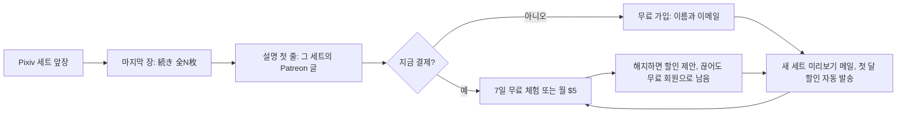

# 페티쉬 이미지 생성기 공략 전략

- 작성일: 2026-10-22
- 수정일: 2026-10-23
- 상태: 실행 전 확인
- 다음 할 일: 14개 Patreon 페이지에 무료 가입 버튼 앞세우기·7일 무료 체험·Autopilot을 한 번 켜고, 생성기 출고 순서를 'Patreon 잠긴 세트 글 → 그 주소를 단 Pixiv 게시'로 바꾼다.
- 연결 폴더: Z:\페티쉬 이미지 생성기
- 바꾼 이유: 두 번째 전략도 거절됐다. 운영자가 원하는 것을 2번 첫머리에 먼저 정의하고, 막힌 곳인 'Pixiv에서 보고 끝나는 문제'를 장치 하나로 풀었다. 결제 대신 무료 가입을 받고 판매는 Patreon 자동 기능에 맡긴다. 파는 것은 '같은 취향 더'가 아니라 '방금 본 세트의 나머지'다. 고정 안내글을 빼고 작품마다 그 세트의 Patreon 글로 바로 보낸다. 02와 08은 Patreon이 금지하는 내용이라 연결하지 않는다.

## 0. 공략 카드

- 한 줄: Pixiv 이용자에게 결제를 조르지 않고 Patreon 무료 가입 한 번만 받는다. 그 뒤 판매와 유지는 Patreon 자동 기능이 한다.
- 파는 것: 방금 Pixiv에서 본 그 세트의 나머지 장과 지금까지 올린 모든 세트. 계정마다 월 $5 한 등급이다.
- Pixiv 게시: 세트 앞 몇 장만 올리고, 마지막 장에 '続き 全N枚'와 나머지 장의 흐린 축소판을 넣는다. 설명 첫 줄은 그 세트의 Patreon 글 주소다.
- Patreon 글: 유료 잠금 위에 노출 없는 표지와 600자 넘는 설정 소개를 둔다. 그래야 무료 회원 모두에게 미리보기 메일이 바로 간다.
- 한 번만 할 설정: 무료 가입 버튼을 앞에 두고 7일 무료 체험을 켠다. Autopilot이라는 자동 판촉 기능도 켠다. 첫 달 할인, 결제를 멈춘 사람 알림, 해지 직전 할인, 만료 알림을 Patreon이 알아서 보낸다.
- 고정 안내글: 뺀다. 한 단계가 늘고, 본 작품을 못 찾고, 광고만 있는 글이라 Pixiv 약관에 가장 직접 걸린다. 프로필에 링크 한 줄만 둔다.
- 운영자 일: 처음 설정과 계정 본인 확인뿐이다. 생성이 멈추면 결제 일시정지 버튼 하나로 책임을 끊는다.
- 주제: Patreon에 올릴 수 있는 12개 계정에 같은 장치를 한꺼번에 건다. 02 최면과 08 관음은 Patreon이 금지해 연결하지 않는다.
- 돈: $5 카드 결제 한 건에서 수수료를 빼면 $4.055가 남는다. 등급 설명에 개수나 일정을 약속하지 않으니 납품 의무가 없다.
- 첫 확인: 2주 뒤 Patreon 통계에서 무료 회원, 체험, 유료 세 숫자를 보고 막힌 칸 하나를 고친다.
- 남은 위험: Pixiv가 외부 유료 링크를 어디까지 봐주는지, 성인 페이지에도 미리보기 메일이 실제로 가는지, Patreon 자동 게시가 되는지는 아직 모른다.

## 1. 한 줄 공략

Pixiv에서 특정 취향 그림을 넘겨 보다 멈춘 사람에게, 그 세트의 나머지가 Patreon에 있다는 것을 그림 안에서 보여 준다. 결제 대신 무료 가입 한 번으로 붙잡고, 그 뒤 미리보기 메일과 첫 달 할인, 무료 체험, 해지 방지는 Patreon이 자동으로 돌려 월 구독으로 바꾼다.

지금까지의 안은 Pixiv에서 본 순간에 돈을 내게 하려 했다. 그 순간은 짧고 사람들은 설명을 안 내린다. 이 안은 그 순간에 연락할 수 있는 상태만 만든다. 파는 일은 사람이 아니라 Patreon이 매일 한다.

## 2. 정한 가정

### 운영자가 원하는 것

이전 두 전략의 거절 기록과 운영자가 직접 한 말, 연결 프로젝트에서 운영자가 확정한 사항으로 정리했다. 틀린 줄이 있으면 그 줄만 고치면 된다.

| 항목 | 운영자가 원하는 것 | 운영자가 한 말 |
|---|---|---|
| 원하는 결과 | 이미 만든 AI 페티쉬 이미지 생성기로 매달 구독료가 들어온다 | 첫 전략을 단건 판매와 일반 그림 시험으로 바꿨다는 이유로 거절 |
| 그대로 둘 것 | 14종, 주제마다 Pixiv와 Patreon 계정 하나씩, Pixiv 하루 2건, AI 자동 생성과 자동 게시 | 계정 운영 명세에 확정 |
| 막힌 곳 | Pixiv에서 그림만 보고 떠난다. 설명을 안 내리고, 링크를 눌러도 본 작품을 못 찾는다 | "밑까지 안 내리는 건 그대로잖아", "왜 바로 그 작품을 못 찾아?" |
| 돈 낼 이유 | '같은 취향 그림 더'보다 확실한 이유 | "뻔한 소리잖아", "아무도 안 사면?" |
| 운영자 일 | 2주 비워도 생성, 게시, 가입, 결제가 돈다. 유료분을 손으로 고르지 않는다 | "매번 유료분을 내가 고르는 거야?", "예외 알림만 하루 수십 개면 똑같이 일이잖아" |
| 책임 | 구독자에게 개수, 마감, 요청, 답장을 약속하지 않는다 | 월간 작품집, 요청, 투표, 커뮤니티 안을 거절 |
| 답의 모양 | 확인 숙제가 아니라 '이렇게 한다'는 장치 하나 | "도통 어케 해야 할지 모르겠네. 딱 좋은 방법이 있을 거다" |
| 하지 않을 것 | 사업 전환, 계정 통합이나 주제 폐기, 사람 승인 공정, 근거 없는 주제 순위, 시간 계산으로 겁주기 | 두 차례 거절과 철회 기록 |

### 이 전략이 정한 것

- 첫 고객은 Pixiv에서 일본어로 그림을 찾는 사람이다. Patreon 소개는 일본어와 영어로 쓴다. 유입처가 Pixiv이고 주제 지식이 일본어 장르 말로 되어 있어서다. 한국 고객을 막지는 않는다.
- 생성기가 같은 인물, 같은 상황으로 여러 장이 이어지는 세트를 만들 수 있다고 본다. 주제별 생산체계에 공통 전개 규칙이 있다. 한 장씩만 나온다면 같은 인물의 이어지는 결과를 묶어 세트로 만든다.
- 연결 프로젝트의 파일, 계정, 설정은 바꾸지 않았다. 실제 설정과 출고 순서 변경은 운영자가 한다.

## 3. 시장

돈은 이렇게 흐른다. Pixiv에서 무료로 보고, Patreon에 무료로 가입하고, 미리보기 메일과 할인과 체험을 받다가 유료로 넘어가 갱신한다. Patreon이 수수료를 떼고 정산한다. Pixiv는 발견하는 곳이고 돈은 Patreon에서만 들어온다.

- **Pixiv 안에서는 돈을 받을 수 없다.** Pixiv의 공식 유료 창구인 FANBOX는 AI 생성물 배포를 제한한다. 그래서 Patreon으로 보내야 한다. [FANBOX 안내](https://fanbox.pixiv.help/hc/ja/articles/20299395982489)
- **Patreon은 판매를 대신 해 주는 기능을 이미 갖고 있다.** 무료 회원은 이름과 이메일만으로 가입한다. 잠긴 글을 올리면 무료 회원에게 미리보기 메일이 자동으로 간다. Autopilot은 무료 회원 첫 달 할인, 결제를 멈춘 사람 알림, 해지 직전 할인, 만료 알림을 알아서 보낸다. 성인 계정도 본인 확인을 마치면 무료 체험과 Autopilot을 쓸 수 있다. [무료 회원](https://support.patreon.com/hc/en-us/articles/16433886029325-How-free-memberships-can-help-grow-your-community), [미리보기 메일](https://support.patreon.com/hc/en-us/articles/48638197166605-How-preview-emails-work-for-your-locked-posts), [Autopilot](https://support.patreon.com/hc/en-us/articles/28030768415629-Automate-your-growth-with-Autopilot), [성인 계정 기능](https://support.patreon.com/hc/en-us/articles/31714988741645-Access-to-Patreon-s-features-and-products-for-Adult-18-creators)
- **성인 페이지는 기본값이 반대다.** 성인 페이지는 유료 가입 버튼이 앞에 나오고 무료 가입은 숨겨져 있다. 페이지 설정에서 무료 가입을 앞으로 돌릴 수 있다. 이 설정 하나가 이 전략의 출발점이다. [무료 회원](https://support.patreon.com/hc/en-us/articles/16433886029325-How-free-memberships-can-help-grow-your-community)

## 4. 개나소나 하는 것

같은 생성 도구를 가진 사람은 대개 한 장짜리 그림에 Patreon 링크를 달고, 여러 등급과 요청, 투표를 둔다. 보는 사람에게는 수백 개 계정의 똑같은 광고다. 눌러도 그 그림과 상관없는 등급표가 나오니 돌아간다.

피할 것은 넷이다.

- 그림과 상관없는 홍보 링크.
- Patreon 첫 화면에서 바로 결제를 요구하는 것. 결제할 마음이 없는 사람을 그대로 잃는다.
- 회원용을 '수위가 더 높다'로 파는 것. Pixiv 약관은 Pixiv에서 금지된 내용을 주고받으려는 외부 링크를 금지한다.
- 등급, 요청, 투표로 차이를 만드는 것. 운영자 일이 된다.

## 5. 고객 수요

| 보는 사람 | 그 순간 원하는 것 | 이 전략이 주는 것 |
|---|---|---|
| 세트 앞장을 보고 멈춘 사람 | 방금 본 장면의 다음 장 | 마지막 장의 '続き 全N枚'와 설명 첫 줄의 그 세트 주소 |
| 끌렸지만 지금 돈 낼 생각은 없는 사람 | 나중에 또 보기 | 무료 가입. 새 세트가 올라올 때마다 미리보기 메일이 간다 |
| 같은 취향을 계속 찾는 사람 | 이 계정의 세트 전부 | 월 $5에 지금까지의 세트 전부, 7일 무료 체험 |
| 유료를 끊으려는 사람 | 돈을 덜 내기 | 해지 직전 할인 제안. 끊어도 무료 회원으로 남는다 |

가장 강한 구매 충동은 '같은 취향 더'가 아니라 방금 본 장면이 어떻게 이어지는지다. 웹툰에서 다음 화를 돈 내고 먼저 보는 것과 같다. 그래서 파는 단위를 그림 한 장에서 세트로 바꿨다.

결제할 마음이 없는 사람이 대부분이라는 것은 처음부터 전제다. 그 사람들을 무료 회원으로 남겨 두는 것이 이 전략에서 쌓이는 자산이다. Patreon은 유료 회원이 해지할 때 80%가 무료 회원으로 남는다고 밝힌다. 이 프로젝트의 구매 자료는 아직 없다. 공개 토론에서 AI 작품 계정과 변신 영상 계정을 구독한다는 말을 두 건 봤지만 약한 단서다. [관측 자료](근거.md)

## 6. 시장 공략점과 첫 진입 지점, 타깃

### 공략점

'Pixiv 세트 앞장에서 Patreon 그 세트의 나머지로' 보내는 장치를, Patreon에 올릴 수 있는 계정 모두에 한꺼번에 건다. 생산 규칙과 출고 규칙이 같아서 계정이 늘어도 사람 일이 늘지 않는다. 계정끼리 숫자를 비교하는 것이 곧 시험이다. 근거 없는 주제 순위는 만들지 않는다.

Patreon은 성적인 그림에서 등장인물 모두가 동의한 것이 드러나야 하고, 최면, 약물, 협박처럼 동의할 수 없는 상황을 금지한다. [커뮤니티 가이드라인](https://www.patreon.com/policy/guidelines) 이 기준으로 14종을 셋으로 나눈다.

| 묶음 | 주제 | Patreon에 올리는 세트 | 세트가 파는 것 |
|---|---|---|---|
| 바로 연결 | 01 TS, 03 하반신, 06 젠더플레이, 09 가슴, 12 키스, 13 POV, 14 젖은옷 | 생성 결과 그대로 | 01과 06은 변화 전후의 이어짐, 03과 09와 14는 같은 인물의 차분, 12는 관계의 진행, 13은 일인칭 시점 유지 |
| 동의가 보이는 설정만 연결 | 04 빙의, 05 교체, 07 얀데레, 10 레즈치녀, 11 발정 | 소개글과 세트에서 동의가 드러나는 설정만 Patreon으로 보낸다. 나머지는 Pixiv에만 올린다 | 04와 05는 두 인물이 바뀌는 과정, 07과 10은 관계, 11은 상태 |
| 연결 안 함 | 02 최면세뇌, 08 관음 | 주제의 중심이 '동의할 수 없음'이라 Patreon이 금지한다 | Pixiv만 운영한다. 돈 받을 곳은 14번 후보에서 찾는다 |

12 키스의 원작 캐릭터 코스프레는 Pixiv에만 올리고, Patreon 세트는 오리지널 인물로만 만든다. 남의 캐릭터로 회비를 받다가 생기는 권리 문제를 피한다.

### 타깃 한 사람

Pixiv 앱에서 좋아하는 태그를 넘겨 보던 사람이 세트 두세 장째에서 멈춘다. 마지막 장에 같은 세트의 흐린 축소판과 '続き 全12枚'가 보인다. 설명 첫 줄을 누르면 그 세트의 Patreon 글이 바로 열리고, 무료 가입과 7일 무료 체험 버튼이 보인다. 이 사람이 누르는 이유는 광고가 아니라 방금 본 것의 뒷장이라는 확신이다.

### 왜 비어 있나, 틀렸다면 어디서 보이나

남들도 Patreon 링크는 단다. 하지만 대부분 그림과 상관없는 등급표로 보내고, 무료 가입과 자동 판촉을 켜지 않은 채 결제만 요구한다. 틀렸을 가능성은 'Pixiv 이용자는 외부 가입 자체를 안 한다'는 쪽이다. 12번의 첫 숫자인 무료 회원 수가 이것을 바로 보여 준다.

## 7. 그 고객이 마음에 쏙 들 공략

| 누구에게 | 주는 것 | 규칙 |
|---|---|---|
| Pixiv에서 보는 사람 | 세트 앞장 | 혼자 봐도 장면이 성립해야 한다. 회원용에 실제로 있는 장수만 '全N枚'로 적는다 |
| 무료 회원 | 새 세트의 표지와 설정 소개 메일 | Patreon이 자동으로 보낸다. 운영자가 쓰는 것은 없다 |
| 유료 회원 | 그 계정 모든 세트의 나머지 장 | 등급 설명은 '이 주제의 모든 세트 전편 열람'으로만 쓴다. 개수, 주기, 요청은 약속하지 않는다 |

유료분은 사람이 고르지 않는다. 세트마다 앞 몇 장은 공개, 나머지는 잠금이다. 공개 앞장보다 나쁜 결과를 뒤에 몰아넣지 않고, 같은 그림의 해상도만 바꾼 장으로 장수를 부풀리지 않는다.

일반 AI 결과와 다른 점은 이어짐이다. 누구나 한 장은 뽑는다. 같은 인물과 같은 상황이 열 장 넘게 이어지면서 주제의 중심(변화 전후, 시점, 관계)이 흐트러지지 않는 세트는 주제 지식과 선별 규칙이 있어야 나온다. 14종의 주제 지식이 이 차이를 만든다.

## 8. 적은 돈과 손으로 찾아오게 하는 법

### Pixiv 게시물 한 개

| 위치 | 넣을 것 | 자동으로 채우는 값 |
|---|---|---|
| 앞 한두 장에서 세 장 | 세트의 앞장. 장면이 성립하는 데까지 | 세트에서 순서대로 |
| 마지막 장 | 같은 세트 나머지의 흐린 축소판과 '続き 全N枚 → キャプション1行目' | 잠긴 장수, 흐리게 만든 축소판 |
| 설명 첫 줄 | 그 세트의 Patreon 글 주소 하나 | 먼저 올린 Patreon 글 주소 |
| 설명 나머지 | 짧은 설정 한두 줄과 정확한 태그 | 주제 지식 |
| 프로필 | Patreon 페이지 주소 한 줄 | 계정마다 고정 |

설명을 안 읽는 사람도 그림은 끝까지 넘긴다. 그래서 알림을 마지막 장에 둔다. 마지막 장은 광고판이 아니라 그 작품의 나머지를 보여 주는 장이고, Pixiv 기준에 맞게 가린다.

### Patreon 페이지와 글

- 페이지: 무료 가입 버튼을 앞에, 월 $5 한 등급, 7일 무료 체험, Autopilot을 켠다. 소개는 일본어와 영어로 '어떤 취향의 세트가 쌓이는 곳인지' 한 문단이다.
- 글 하나에 세트 하나: 제목은 Pixiv와 같다. 유료 잠금 위에 노출 없는 표지 한 장과 설정 소개를 두고, 잠금 아래에 세트 전부를 둔다.
- 잠금 위에 600자 넘는 글과 이미지가 있으면 무료 회원 모두에게 미리보기 메일이 바로 간다. 짧으면 한 사람에게 3일에 한 번꼴로만 간다. [미리보기 메일](https://support.patreon.com/hc/en-us/articles/48638197166605-How-preview-emails-work-for-your-locked-posts)
- 성인 페이지에서 잠금 위, 표지, 상점 미리보기는 누구나 보는 곳이라 노출이나 성적 장면을 넣을 수 없다. 흐리게 하거나 잘라 낸 표지, 상황 설명은 된다. [공개 미리보기 기준](https://support.patreon.com/hc/en-us/articles/36188028163725-Understanding-Public-Previews-and-Commerce-guidelines-for-adult-18-creators)

### 처음 할 일과 반복할 일

- 처음 한 번: 14개 Patreon 페이지 설정(무료 가입 앞으로, 체험, Autopilot, 한 등급), 프로필 링크, 생성기 출고 순서 변경.
- 반복할 일: 없다. 홍보 글, 댓글, DM을 하지 않는다. 새 세트가 곧 새 미리보기 메일이고, 예전 Pixiv 게시물도 계속 자기 세트로 보낸다.
- 덤: 18세 이상 Patreon 이용자는 설정을 바꾸면 Patreon 검색에서 성인 페이지를 찾을 수 있다. 일 없이 생기는 두 번째 발견 경로다. [성인 계정 기능](https://support.patreon.com/hc/en-us/articles/31714988741645-Access-to-Patreon-s-features-and-products-for-Adult-18-creators)

## 9. 계속 만드는 규칙

### 세트 만드는 법

주제, 인물, 상황을 정하면 세트 하나가 나온다. 세트 안에서는 인물과 화풍과 주제의 중심을 고정하고, 장마다 진행이나 각도나 차분을 바꾼다. 세트끼리는 인물, 장소, 의상을 바꾼다. 장수가 많다고 가치가 생기지 않는다. 앞장만 보고도 뒤가 궁금한 진행이 있어야 한다.

| 주제 묶음 | 세트가 이어지는 방식 |
|---|---|
| 변화형(01, 04, 05, 06) | 바뀌기 전, 바뀌는 중, 바뀐 뒤 |
| 한 장 매력형(03, 09, 13, 14) | 같은 인물의 의상, 자세, 각도 차분 |
| 관계·상태형(07, 10, 11, 12) | 두 인물의 관계가 진행되는 흐름. 동의가 보여야 한다 |

### 출고 순서 (하루 2건 그대로)

1. 세트를 만들고 자동으로 고른다. 깨진 장은 버리고, 남은 장으로 세트가 안 되면 세트째 버린다. 사람에게 묻지 않는다.
2. 동의 검사: 6번의 '동의가 보이는 설정만' 묶음은 설정 값에서 동의가 확인될 때만 Patreon으로 보낸다. 아니면 Pixiv에만 올린다.
3. 노출 없는 표지와 설정 소개를 만든다. 하루 첫 세트는 600자를 넘겨 바로 발송되게 하고, 둘째 세트는 짧게 써서 Patreon이 간격을 두고 보내게 한다. 무료 회원 메일함에 하루 두 통씩 쌓이면 수신 거부가 늘기 때문이다.
4. Patreon에 잠긴 글을 올리고 주소를 받는다.
5. 그 주소를 설명 첫 줄에 넣고 Pixiv에 앞장과 마지막 장을 올린다.
6. 4번이 실패하면 링크 줄을 빼고 Pixiv에만 올린다. 없는 회원용을 약속하지 않는다.

같은 원인의 실패가 반복되면 원인마다 한 번만 알린다. 버려도 되는 결과는 알리지 않는다.

### 자동화에서 비어 있는 곳

Patreon 공개 API에는 이미지 글을 올리는 정식 기능이 없다. 4번은 생성기가 브라우저로 자동 게시해야 하고, 실제 사이트에서 성공한 적은 아직 없다. [API 문서](https://docs.patreon.com/) Pixiv 예약은 한 번에 10작품, 1주일 앞까지다. [예약 기능](https://www.pixiv.help/hc/en-us/articles/115003430413-I-want-to-schedule-the-date-and-time-of-my-posts)

## 10. 돈이 남고 오래 버는 법

| 항목 | 내용 |
|---|---|
| 가격 | 계정마다 월 $5 한 등급. Patreon이 새 멤버십의 출발 가격으로 $5를 권한다. [멤버십 구성](https://support.patreon.com/hc/en-us/articles/8293538677005-Setting-Up-Your-Membership-Program) |
| 수수료 | 2025-08-04 뒤에 연 페이지는 10%에 카드 처리비 2.9% + $0.30이다. $5 한 건이면 $4.055가 남는다. 환전, 출금, 환불, 세금은 더 빠진다. [수수료](https://support.patreon.com/hc/en-us/articles/11111747095181-Creator-fees-overview) |
| 계산 | 월 남는 돈 = 유료 회원 수 × 4.055 − 환불 − 늘어난 생성과 저장 비용. 유료 회원은 무료 회원 중 넘어온 사람과 바로 유료로 온 사람으로 늘고 해지로 준다. 넘어오는 비율은 아직 모르고 2주 숫자로 채운다 |
| 오래가는 이유 | 무료 회원 명단이 쌓인다. Pixiv 노출이 줄거나 계정이 막혀도 무료 회원에게는 새 세트 메일이 계속 간다. 세트가 쌓일수록 체험 7일 동안 볼 것도 많아진다 |
| 책임 끊는 법 | 생성이 멈추면 결제 일시정지를 누른다. 기존 회원은 그달 결제되지 않고 계속 볼 수 있다. 새로 가입하는 사람은 가입할 때 결제된다. 한 달 단위다. [결제 일시정지](https://support.patreon.com/hc/en-us/articles/214013323-How-to-pause-billing-for-your-members) |
| 나중에 켤 것 | 연간 멤버십. 페이지를 연 지 3개월이 넘고 최근 3개월 동안 월 $200 넘게 벌어야 켤 수 있다 |
| 넣지 않을 것 | 등급 여러 개, 요청권, 투표, 커뮤니티 채팅, 개별 DM |

## 11. 조심할 점

| 무엇 | 규칙 | 이 전략의 대응 |
|---|---|---|
| Pixiv 약관 14조 | Pixiv가 인정한 것 말고는 상업 광고나 홍보 목적 투고 금지. Pixiv에서 금지된 내용을 주고받으려는 외부 링크 금지 [약관](https://policies.pixiv.net/) | 광고만 있는 글(고정 안내글)을 두지 않는다. 링크는 작품마다 한 줄로 그 작품의 나머지에만 보낸다. Patreon 회원용도 Pixiv와 같은 기준으로 가린다. 외부 유료 링크를 어디까지 봐주는지는 약관만으로 알 수 없다 |
| Pixiv 검색 숨김 | 홍보 목적으로 너무 많이 올린 작품은 검색에서 기본으로 숨긴다 [검색 기준](https://www.pixiv.help/hc/en-us/articles/56357843452313-What-are-works-that-are-likely-to-violate-the-Guidelines-in-work-search) | 하루 2건을 늘리지 않는다 |
| Pixiv 안드로이드 앱 | 일부 계정은 프로필과 설명의 링크가 안 보이거나 안 눌린다 [링크 안내](https://www.pixiv.help/hc/en-us/articles/45853006255897-Links-in-profiles-and-captions-may-not-work-Android-app) | 마지막 장에 계정 이름을 넣어 Patreon 검색으로도 찾게 한다 |
| Patreon 동의 규정 | 최면, 약물, 협박 상황과 동의할 수 없는 인물의 성적 묘사 금지 [커뮤니티 가이드라인](https://www.patreon.com/policy/guidelines) | 6번의 세 묶음과 9번의 동의 검사 |
| Patreon AI 규정 | 성인 페이지의 AI 인물은 일러스트나 애니메이션풍만 된다 [성인 AI 안내](https://support.patreon.com/hc/en-us/articles/34055590411789-Understanding-Patreon-s-AI-policies-for-Adult-18-creators) | 실사풍으로 넘어가지 않게 화풍을 고정한다 |
| 결제 경로 | 성인 페이지는 웹과 안드로이드에서만 결제된다. iOS 앱에서는 무료 체험도 안 된다 [무료 체험](https://support.patreon.com/hc/en-us/articles/16049074630029-Starting-a-Free-Trial) | 아이폰 사용자는 브라우저에서 가입한다. Pixiv 링크는 브라우저로 열린다 |
| 본인 확인 | 성인 페이지는 계정마다 본인 확인을 해야 체험과 Autopilot을 쓴다. 인증 정보는 공개되지 않는다 [인증 FAQ](https://support.patreon.com/hc/en-us/articles/8335062384141-Age-Verification-Frequently-Asked-Questions-FAQ) | 처음 설정 때 한 번 |

## 12. 보면서 고칠 것

설정을 켜고 2주 동안 그대로 둔다. 그 뒤 Patreon 통계에서 계정마다 세 숫자만 본다. 한 번에 하나만 바꾼다. [통계](https://support.patreon.com/hc/en-us/articles/207346316-Insights-dashboards)

| 보이는 숫자 | 막힌 곳 | 고칠 것 |
|---|---|---|
| Pixiv 조회는 있는데 무료 회원이 거의 없다 | Pixiv에서 Patreon으로 넘어가는 곳 | 마지막 장의 '続き' 크기와 문구, 웹과 앱에서 링크가 눌리는지. 조회 자체가 거의 없으면 아직 판단하지 않는다 |
| 무료 회원은 쌓이는데 체험과 유료가 없다 | 미리보기 메일이 약하거나 안 간다 | 잠금 위 600자와 표지가 지켜졌는지, Autopilot 화면에서 메일이 나갔는지 |
| 체험은 많은데 7일 안에 해지한다 | 쌓인 세트만 보고 떠난다 | 새 세트의 진행이 약하지 않은지. 그래도 같으면 체험을 끄고 비교한다 |
| 유료가 첫 달 뒤 빠진다 | 다음 달에 볼 것이 약하다 | 같은 계정의 세트가 취향의 중심을 지키는지 |
| 계정마다 차이가 크다 | 주제마다 장치가 맞는 정도 | 잘되는 계정의 세트 모양을 같은 묶음 계정에 옮긴다 |

무료 회원이 쌓이는 동안은 실패가 아니다. 그 사람들에게는 새 세트마다 메일이 계속 간다.

## 13. 같은 자산으로 넓힐 시장

| 순서 | 넓힐 곳 | 그대로 쓰는 것 | 새로 할 일 |
|---|---|---|---|
| 1 | Patreon 검색으로 찾아오는 18세 이상 이용자 | 같은 페이지와 세트 | 없다. 영어 소개만 정확하게 쓴다 |
| 2 | 연간 멤버십 | 같은 등급 | 조건(3개월 연속 월 $200 넘는 수입)을 채우면 켠다 |
| 3 | Pixiv의 영어권 이용자 | 같은 게시물 | 제목과 태그에 영어를 함께 쓴다 |

같은 그림을 다른 계정이나 다른 판매처에 그대로 올리지 않는다. 같은 고객을 나눌 뿐이다.

## 14. 다음에 발굴할 시장

| 후보 | 왜 | 아직 모르는 것 | 가장 싼 확인 |
|---|---|---|---|
| 02와 08을 DLsite, FANZA의 AI 작품 매장에서 단건 판매 | 일본 동인 시장에서 최면과 관음은 큰 장르다. 두 곳 모두 AI 작품 전용 매장이 있다. 단건이라 팔고 나면 납품 의무가 없다 | 공식 원문을 아직 못 봤다. 2차 자료로는 판매자 단위로 월 3작품 제한이 있고, DLsite AI 작품은 일본 IP에서만 산다고 한다 | 두 곳 판매자 안내에서 AI 작품 수 제한, 결제, 한국 판매자 가입 조건을 확인한다 |
| 반응 좋은 세트의 묶음 단건 판매 | 체험만 하고 떠나는 사람에게 다른 지불 방법 | 구독 매출을 깎아 먹는지 | 12번에서 체험 뒤 해지가 많을 때만 검토한다 |

[DLsite AI 규정 정리(2차 자료)](https://aiteller.jp/blog/dlsite-ai-kiyaku), [FANZA 월 3작품 제한(2차 자료)](https://note.com/morinojaws/n/ncae989b58af6)

## 15. 반론과 확인할 전제

### 이전 전략과 달라진 것

| 이전 전략 | 이번 전략 | 이유 |
|---|---|---|
| 작은 안내 → 고정 안내글 → Patreon 결제 | 마지막 장 → 그 세트 글 → 무료 가입 → 자동 판매 | 한 순간에 결제를 요구하면 대부분 잃는다. 무료 가입은 그 순간을 나중으로 미룬다 |
| 같은 취향을 계속 주는 피드 | 방금 본 세트의 나머지 | 운영자가 뻔하다고 했다. 다음 장이 더 강한 이유다 |
| 고정 안내글 하나로 관리 | 작품마다 그 세트 주소 | "왜 바로 그 작품을 못 찾아?"에 대한 답이다. 광고만 있는 글은 약관에도 가장 직접 걸린다 |
| 02와 08은 미해결 | 02와 08은 Patreon 연결 안 함, 단건 매장 후보 | Patreon이 최면을 명시적으로 금지한다 |

### 결론을 바꿀 수 있는 반론

| 반론 | 답 | 아직 모르는 것 |
|---|---|---|
| "Pixiv 이용자는 외부 가입 자체를 안 해" | 결제보다 무료 가입이 훨씬 가볍다. 이름과 이메일만 넣으면 된다. 그래도 안 하면 2주 뒤 무료 회원 수로 바로 보인다 | 실제로 넘어오는 비율 |
| "미리보기 메일이 성인 페이지에도 가?" | 도움말은 모든 창작자에게 기본으로 켜져 있다고 하고 성인 제외 문구는 없다. 이미지는 흐리게 나간다 | 실제로 가는지는 계정의 Autopilot 화면에서 보인다 |
| "Pixiv가 Patreon 링크로 계정을 막으면?" | 광고만 있는 글을 없애고 작품마다 한 줄로 줄였다. 막혀도 Patreon 무료 회원은 남는다 | Pixiv가 외부 유료 링크를 어디까지 봐주는지 |
| "무료 체험으로 다 보고 나가면?" | 해지 할인과 무료 회원 잔류가 자동으로 붙는다. 그래도 많으면 체험을 끈다 | 체험 뒤 남는 비율 |
| "결국 매일 생산해야 하잖아" | 이미 하기로 한 하루 2건을 그대로 쓴다. 등급 설명에 개수와 주기를 약속하지 않고, 멈추면 결제를 일시정지한다 | 생성기가 사람 없이 도는지 |
| "Patreon 자동 게시가 안 되면?" | 이때만 사람이 끼어든다. 실패하면 Pixiv에만 링크 없이 올려 거짓 약속을 막는다 | 브라우저 자동 게시 성공 여부 |

이 안도 판매를 보장하지는 않는다. 다만 막힌 곳에 대한 답은 하나로 정했다. 결제 대신 무료 가입을 받고, 판매는 Patreon이 자동으로 한다.

## 16. 출처

공식 원문은 2026-10-23에 다시 열었다. 확인 날짜와 적용 범위, 전략에 반영한 점은 [근거.md](근거.md) 12번에 있다. DLsite와 FANZA는 공식 원문을 열지 못해 14번 후보로만 두었다. 14종 분류는 연결 프로젝트의 주제 설정이며 매출 자료가 아니다. 공개 구독 진술 두 건은 [관측 자료](원자료-2026-10-22.csv)에 있다. 개인 이름과 연락처, 계정 비밀은 수집하지 않았다.
