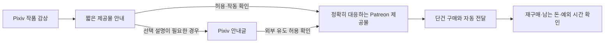

# 페티쉬 이미지 생성기 공략 전략

- 작성일: 2026-10-22
- 수정일: 2026-10-22
- 상태: 실행 전 확인
- 다음 할 일: 한 브랜드의 기존 완성본으로 상품 차이·외부 이동 허용 범위·Patreon 판매 기능을 확인한다.
- 연결 폴더: Z:\페티쉬 이미지 생성기
- 바꾼 이유: 10월 17일 거절된 구독·월간 작품집 안을 재사용하지 않고, 새 납품 의무를 최소화하는 판매 방식부터 다시 비교했다. 내부 링크의 안전성, 14종의 독립 수요, 무인 운영을 입증되지 않은 전제로 분리했다.

## 0. 공략 카드

- 공략: 이미 완성된 취향별 일러스트의 구매부터 확인하고, 반복 구매가 있을 때만 구독을 붙인다.
- 주력: 한 브랜드의 완결 작품 판매다. 14개 주제·계정 분리 구상은 보존하되 유료 약속을 한꺼번에 만들지 않는다.
- 첫 대상: 06 젠더플레이의 비노골적 캐릭터 표현부터 운영 부담을 시험한다. 인기·매출 1위라는 뜻은 아니다.
- 전환: 긴 글을 읽히려 하지 말고, 작품 가까이에 구매 차이를 알리고 설명 첫 줄에서 정확한 제공물로 연결한다.
- 내부 안내글: 찾기·조건 안내에 도움이 될 때만 쓴다. 내부 링크의 제재 면제 근거는 확인되지 않았다. [Pixiv 기준](https://policies.pixiv.net/)
- Patreon: 첫 시험값은 단건 $5다. 이후 납기·개별 요청 없는 단일 등급 구독을 검토하며, 계정별 판매 조건은 확인이 필요하다. [판매 조건](https://support.patreon.com/hc/en-us/articles/16303719836813-Selling-one-time-purchases-on-Patreon)
- 생산: 같은 원본으로 공개본·제공물·안내를 만들되, 선별 실패분을 사람이 매번 수선하는 운영은 피한다.
- 부담: 개인 주문·투표·채팅·영상·월간 납기 약속은 초기 혜택에서 뺀다. 인증·분쟁·정산 책임은 남는다.
- 비용: 새 광고·도구 결제 없이 기존 자산부터 쓴다. 생성·검수·게시·수수료·출금 비용을 합쳐 남는 돈을 본다.
- 14종 판단: 서로 겹치는 분류가 많고 이 프로젝트의 구매 증거는 없다. 특히 최면·관음의 현재 방향은 Patreon 동의 규정과 충돌할 수 있다. [콘텐츠 기준](https://www.patreon.com/policy/guidelines)
- 첫 확인·확장: 상품 차이와 이동 경로를 먼저 확인하고, 실제 결제·재구매·예외 처리 시간을 근거로 다음 브랜드를 연다.
- 가장 큰 미확인: 무료 감상자를 구매자로 바꿀 가치와 전 과정 자동 게시다. 상세 검토와 출처는 본문·근거 파일에 있다.

## 1. 한 줄 공략

특정 캐릭터 표현과 화풍을 반복해서 찾지만 직접 생성·선별하는 수고는 원하지 않는 이용자에게, 공개 작품과 정확히 대응하는 완성된 일러스트를 쉽게 확인하고 받게 하여 그 이용 대가를 Patreon에서 받는다.

**지금 먼저 풀 것은 ‘왜 밑의 글을 안 읽는가’보다 ‘무료로 본 뒤에도 왜 결제해야 하는가’다.** 좋은 무료 그림을 충분히 감상한 사람은 글을 읽어도 떠날 수 있다. 설명을 읽게 만드는 기술만으로 구매 차이를 대신할 수 없다. 이것은 현재 계정의 행동을 관측한 결론이 아니라, 먼저 반증할 사업 가설이다.

이 문서는 기존 14종을 비노골적으로 분석하고, 일반 일러스트에도 적용되는 상품·구매 동선·운영 조건을 정한다. 성적 장면이나 생성 프롬프트를 새로 작성하는 문서는 아니다.

## 2. 정한 가정

AI 제작과 자동화는 유지한다. 경쟁자도 같은 생성 기술을 쓰며 고객도 직접 만들 수 있다. 운영자의 얼굴·실명·사생활이나 친밀한 교류를 판매하지 않는다. ‘책임지기 싫다’는 요구는 **추가 납품과 개별 대응의 원인을 최대한 없애라**는 뜻으로 읽는다. 결제 오류·권리 분쟁까지 책임이 사라진다고 해석하지 않는다.

확인한 현재 상태는 다음과 같다.

| 구분 | 확인한 것 | 아직 확인하지 않은 것 |
|---|---|---|
| 제작 | NovelAI 생성 경로, 14개 `theme.json`, 주제별 지식과 화풍 파일이 있다 | 실제 이미지의 일관성·품질·폐기율·상업 이용 조건의 개별 충족 |
| 운영 | 기존 문서는 주제별 Pixiv 1개·Patreon 1개, Pixiv 하루 2건 계획을 확정 사항으로 기록한다 | 실제 28개 계정의 개설·인증·연결·허용 상태 |
| 게시 | 게시 큐·중복 방지·계정 대조에 관한 문서와 구현이 있다 | 실사이트에서의 정상 게시, Patreon 게시, 장기간 무인 운영 |
| 실적 | 태그 DB를 읽기 전용으로 재조회했다 | 이 프로젝트의 유료 구매·이동·유지·정산 실적 |
| 과거 제안 | 첫 운영전략과 월간 작품집 제안은 사용자 거절로 철회됐다 | 거절의 세부 이유 전체를 담은 대화 원문 |

연결 폴더는 읽기만 했다. 계정 분리·생성 설정·업로드 프로그램을 바꾸지 않았다. 계정별 하루 2건도 임의로 변경하지 않았다. 아래의 판매 순서와 운영 한도는 **이번 권고**이며 적용 완료된 설정이 아니다.

초기 고객은 일본어로 작품을 찾는 Pixiv 이용자를 중심으로 잡고, 영어 안내를 보조로 둔다. 기존 분류·지식에 일본어 장르 표현이 많고 유입처를 Pixiv로 지정했기 때문이다. 일본 고객의 결제율이 높다는 증거는 없다. 한국어는 운영 문서 언어로 두며 한국 고객을 막지 않는다. 네 언어의 긴 캡션을 매번 제작하지 않는다. Patreon 도착지의 가격·구매 범위는 앞에서 본 언어로 이해할 수 있어야 한다.

## 3. 시장

돈의 흐름은 `작품 발견 → 무료 감상 → 제공물 확인 → 결제 → 파일·열람권 전달 → 수수료·환불 차감 → 출금`이다. Pixiv 조회가 곧 돈은 아니며, Patreon 방문·무료 회원도 매출이 아니다. 이 프로젝트에 실제 돈을 낸 고객 자료는 아직 없다.

가능한 사업 구조를 운영 부담으로 비교하면 다음과 같다.

| 방식 | 돈을 받는 이유 | 새로 생기는 부담 | 이번 선택 |
|---|---|---|---|
| 완성된 작품 단건 판매 | 지금 확인한 특정 제공물을 받는다 | 상품별 설명·접근 오류·환불 | 우선 검토한다 |
| 계속 갱신되는 구독 | 반복해서 원하는 작품을 받고 찾는 수고를 줄인다 | 다음 결제 때도 남을 이유·갱신·해지 관리 | 재구매와 공급 안정성을 본 뒤 검토한다 |
| 개인 주문·수정·친밀한 교류 | 내 요구를 반영해 준다 | 주문 해석·불만·수정·기대 관리 | 운영자 조건과 맞지 않는다 |
| 후원만 받기 | 창작자 활동을 지지한다 | 관계와 명성에 의존할 가능성 | 기존 지지층을 가정하지 않으므로 주력으로 삼지 않는다 |
| 생성기·프롬프트 판매 | 소비 대신 제작을 돕는다 | 도구 지원·재현성·이용 조건 | 다른 사업이며 초기 상품에 넣지 않는다 |

Patreon 공식 판매 안내는 단건 판매를 지원하며, Adult/18+ 계정은 인증과 subscription billing 등 조건을 확인해야 한다. **판매자가 쓰는 과금 체계와 구매자가 월 구독해야 하는지는 다른 문제다.** 단건 구매자는 멤버십 없이 구매물을 받을 수 있다고 안내한다. 실제 계정의 Shop 활성화는 미확인이다. [단건 판매 안내](https://support.patreon.com/hc/en-us/articles/16303719836813-Selling-one-time-purchases-on-Patreon), [성인 계정 기능](https://support.patreon.com/hc/en-us/articles/31714988741645-Access-to-Patreon-s-features-and-products-for-Adult-18-creators)

같은 계열인 FANBOX를 곧바로 대안으로 삼지는 않는다. FANBOX는 주요 제작 과정에 AI를 사용한 콘텐츠의 공개와 그 배포를 위한 외부 유도를 제한한다. Pixiv 본체의 정책과 별개다. [FANBOX 공식 안내](https://fanbox.pixiv.help/hc/ja/articles/20299395982489)

## 4. 개나소나 하는 것

아래는 현재 시장의 공급 비율을 측정한 결과가 아니라, 같은 AI를 가진 경쟁자가 쉽게 복제할 수 있어 피할 방식이다.

- 일반적인 그림을 많이 만들고 장수·해상도만으로 유료 가치를 주장한다. 무료 대체재와 고객의 직접 생성보다 무엇이 나은지 남지 않는다.
- 모든 주제에 같은 10장 전개·같은 유료 혜택을 적용한다. 제작기의 분류 편의가 구매 이유를 대신한다.
- 멤버십 가격을 먼저 만들고 혜택 칸을 투표·요청·제작 과정으로 채운다. 돈을 받기 전에 사람이 할 일을 늘린다.
- 무료 그림의 일부를 가리거나 결말을 끊기만 하면 돈을 낸다고 가정한다. 관심보다 불신과 이탈을 만들 가능성도 있다.
- 14개 채널의 게시량을 수입원 14개로 계산한다. 같은 고객·플랫폼·결제 정책에 묶이면 수요도 위험도 겹친다.

2024년 Pixiv 연구는 대규모 AI 게시물 공급을 이미 관측했다. 현재 14종의 경쟁도나 매출을 증명하는 자료는 아니다. ‘AI로 생산 가능’ 자체가 새 경쟁 우위가 아니라는 배경으로만 쓴다. [연구 원문](https://arxiv.org/abs/2402.18463)

## 5. 고객 수요

‘이 주제를 좋아한다’와 ‘이 판매자에게 돈을 낸다’를 분리한다. 아래 필요는 검증할 가설이다.

| 이용자 | 지금 하는 행동·대안 | 돈을 낼 수 있는 이유 | 돈을 안 낼 이유 |
|---|---|---|---|
| 잠깐 감상하는 사람 | 피드에서 보고 다음 무료 작품으로 간다 | 대체하기 어려운 특정 작품을 발견했을 때 | 현재 이미지로 충분하다 |
| 특정 표현을 반복해서 찾는 사람 | 여러 계정·태그에서 찾고 저장한다 | 좋아한 특징이 실제 제공물에도 이어지고, 찾고 거르는 수고가 줄 때 | 계정이 다른 취향으로 흐르거나 유료분이 중복일 때 |
| 스스로 AI를 쓰는 사람 | 생성·선별·수정한다 | 자기 시간과 시행착오보다 완성본 구매가 쌀 때 | 같은 결과를 쉽게 만들거나 제작 자체를 즐길 때 |
| 기존 구매자 | 전에 산 작품을 다시 열고 다음 작품을 살핀다 | 전 구매 만족과 다음 작품의 새 가치가 함께 있을 때 | 이미 원하는 것을 충분히 모았을 때 |

대상은 모든 감상자가 아니라 두 번째·네 번째 집단이다. 그러나 이 집단이 이 프로젝트에 충분히 있는지는 미확인이다. 취향의 희소성만으로 지불 의사를 확정하지 않는다.

공개 토론에서는 AI 작품 계정을 간헐적으로 구독한다는 진술과, 변신을 다루는 AI 영상 계정 세 곳을 구독한다는 진술을 확인했다. 앞의 사례는 간헐적 구매 가능성을 보여 주고, 뒤의 사례는 직접 재현하는 수고가 구매 이유가 될 수 있음을 보여 준다. 다만 **같은 토론의 자기 진술 두 건이며 영수증·유지 기간은 확인하지 못했다. 영상 구매를 이 프로젝트의 이미지 수요로 바꿔 읽을 수 없다.** 이 약한 근거는 ‘AI라서 아무도 돈을 안 낸다’는 단정을 피하는 정도로만 쓴다. [진술 A](https://www.reddit.com/r/patreon/comments/1opa3n8/comment/nncbc56/), [진술 B](https://www.reddit.com/r/patreon/comments/1opa3n8/comment/nncek6a/)

로컬 `pixiv_tags.db`의 46,498행 중 `access_count`, `demand_score`, `r18_count`는 전부 0이었다. 이것은 **측정 부재**로 다룬다. `artwork_count`는 공급에 관한 저장값이며 갱신 시점과 수집 조건도 현재 수요 측정에 충분하지 않다. 태그 수·북마크·조회에서 구매율을 만들어 내지 않는다. 조사 범위와 SQL은 [근거](근거.md)에 남겼다.

## 6. 시장 공략점과 첫 진입 지점, 타깃

### 14종이 같은 크기의 시장 14개는 아니다

정체성·상황을 다루는 01·04·05·06, 관계·성격을 다루는 07·10·12, 부위·상태를 다루는 03·09·11·14, 표현 시점인 13이 섞여 있다. 02·08은 설정 자체가 플랫폼의 동의 기준과 만날 수 있다. 같은 그림이 여러 분류에 들어가므로 시장 크기를 합산할 수 없다.

아래 판단은 **현재 설정 문서에 대한 사업 구조 검토**다. 실제 이미지의 품질 심사, 구매자 조사, 주제별 유료 실적을 대신하지 않는다. 정책 조건은 11번에서 다룬다.

| 주제 | 독립 구매 이유가 생길 조건 | 지금 안 먹힐 수 있는 이유 | 운영 부담·정책 문제 | 이번 판단·확인할 것 |
|---|---|---|---|---|
| 01 TS | 정체성 변화라는 설정이 감상 경험에 실제 차이를 만든다 | 그림만으로는 04·05와 구분이 안 되고 설명을 읽어야 할 수 있다 | 연속 작품의 인물·설정 일관성 검수가 늘어난다 | 장르 가설은 남긴다. 설명 없이 구분되는지 먼저 확인하며 구매 1순위로 단정하지 않는다 |
| 02 최면세뇌 | 설정에 대한 별도 관심은 있을 수 있다 | 관심과 판매 가능한 표현은 별개다 | 현행 Patreon은 동의 능력이 없는 상황의 예로 최면을 명시한다 | 현재 방향의 성적 상품은 판매 전제에서 뺀다. 비성적인 판타지로 바꾸면 다른 고객 가설이므로 따로 검증한다 |
| 03 하반신 | 특정 조형·의상 표현에 대한 일관된 감상 가치가 있다 | 큰 부위 분류만으로는 무료 대체재와 차이가 약하다 | 손발·의상·구도 오류를 고객이 바로 알아볼 수 있다 | 독립 구독보다 완성본의 구매 차이부터 검증한다. 장수만 늘리면 개선되지 않는다 |
| 04 MTF빙의 | 01·05와 다른 설정을 실제 작품에서 이해할 수 있다 | 핵심 설정이 이미지 밖 설명에만 있을 수 있다 | 신체 주체·동의 해석과 서사 일관성의 확인 부담이 크다 | 첫 무인 판매 시험에서는 뒤에 둔다. 명칭만 바꾼 중복인지와 허용 범위를 먼저 가린다 |
| 05 MTF교체 | 서로 다른 정체성의 교체를 알아보는 경험 자체가 가치다 | 현재 단독 인물 중심 규칙에서는 ‘교체’를 입증하기 어려울 수 있다 | 여러 인물·이전 상태의 연속성을 지키는 비용이 생긴다 | 01과 구분되는 구매 행동이 있을 때 별도 확장을 정당화한다 |
| 06 젠더플레이 | 변신과 다른 캐릭터·스타일 표현을 반복해서 찾는다 | 흔한 캐릭터 그림처럼 보이면 분류 이름만으로는 돈을 못 받는다 | 단일 인물의 비노골적 표현에서는 복잡한 사건 설명을 줄일 여지가 있다 | 첫 운영 시험 후보로 정한다. 판매성 우승이 아니라 비교적 단순한 전달·검수 구조라는 판단이다 |
| 07 얀데레 | 성격과 관계 표현이 실제로 읽힌다 | 표정 하나를 반복하는 것으로는 다른 그림과 차이가 약하다 | 현재 지식에 집착·감금 등 서로 다른 수위가 섞여 있어 자동 판정 부담이 있다 | 비폭력·상호 동의 범위와 현재 설정을 대조한 뒤 검토한다. 장르 전체를 금지라고 하지는 않는다 |
| 08 관음 | 특정 시점·관찰 방식에 관심이 있을 수 있다 | 현재 설정은 상대가 촬영을 인지하지 않는 것을 핵심으로 둔다 | 비동의적 성적 표현과 충돌할 가능성이 크다 | 현재 방향을 Patreon 주력에 넣지 않는다. 일반 관찰 시점으로 바꾸는 것은 같은 수요가 유지된다는 보장이 없다 |
| 09 가슴 | 특정 조형·의상 표현을 원하는 고객이 있다 | 03과 마찬가지로 부위 이름만으로 독점적 가치가 생기지 않는다 | 착의 여부만으로 성인 분류·공개 허용을 판정할 수 없다 | 정책 통과와 구매 차이를 별도로 확인한다. 인기일 것이라는 추정으로 물량을 늘리지 않는다 |
| 10 레즈치녀 | 여성 간 관계를 다루는 표현의 일관성이 있다 | 성적 지향·등장인물 수만으로 단일 고객 취향이 되지는 않는다 | 두 인물의 접촉·손·시선·동의에 대한 검수가 늘어난다 | 동성 관계 자체는 문제 삼지 않는다. 강압을 포함하는지와 실제 오류율을 먼저 확인한다 |
| 11 발정 | 특정 감정·상태 표현에 관심이 있다 | ‘상태’는 다른 13종에도 겹치며 단독 브랜드의 약속이 모호하다 | 동의 능력이 불명확한 표현과 공개 분류 오류를 주의해야 한다 | 독립 유료 수요 증거가 약하다. 현재 설정의 정책 적합성부터 확인한다 |
| 12 키스 | 성인 오리지널 캐릭터의 비노골적 로맨스 감상을 반복해서 원한다 | 기존 설정은 IP 코스프레에 기대고 있어 관심이 브랜드보다 원작에 붙을 수 있다 | 원작 이름을 안 쓰는 규칙만으로 이용 권리가 생기지 않는다 | 권리를 확인한 오리지널 범위는 후속 시험 후보다. 기존 IP 인기를 새 브랜드 수요로 계산하지 않는다 |
| 13 POV | 1인칭 관점 자체에 반복 구매 선호가 있다 | 제작 문서상 다른 주제에도 켜는 표현 옵션이다 | 브랜드 간 중복과 신체·시점 오류가 생길 수 있다 | 계정은 보존하되 독립 시장으로 확정하지 않는다. 다른 주제와 구매자가 겹치는지부터 확인한다 |
| 14 젖은옷 | 의상·소재·날씨 표현을 감상하는 가치가 있다 | 눈길을 끄는 한 장만으로 만족하면 반복 결제 이유가 약하다 | 옷의 형태·재질 일관성, 공개 가능 수위의 확인이 필요하다 | 비노골적 소재 표현은 06 다음 비교 후보다. 반복 효과가 단순 중복인지 구매 행동으로 본다 |

첫 고객은 ‘06의 캐릭터 표현을 보고 비슷한 품질의 작품을 더 찾지만, 직접 생성·수정할 의욕은 없는 이용자’로 정한다. 성별·나이·소득을 추정해 페르소나를 꾸미지 않는다.

확장 순서는 **06의 운영 구조 확인 → 14의 다른 감상 필요 확인 → 01·05의 설정 이해와 별도 구매 확인**으로 권고한다. 이는 신규 시행 순서다. 기존 계정에 실제 구매·정산 자료가 있다면 그 증거가 이 순서보다 우선한다. 14개 계정을 합치거나 삭제하라는 뜻은 아니다.

쌓을 자산은 생성 프롬프트의 개수보다 ‘공개 작품과 제공물의 일치 기록, 품질 실패 사례, 고객이 다시 선택한 특징, 정확한 분류, 오래 작동하는 상품 주소’다. 경쟁자가 이미지를 따라 만들어도 납품 신뢰와 실제 구매 학습은 즉시 복제되지 않는다. 다만 이것도 강한 독점 장벽이라고 과장하지 않는다.

## 7. 그 고객이 마음에 쏙 들 공략

### Patreon에는 무엇을 둘 것인가

**이미 존재하는 완성된 제공물에 가격을 붙인다.** 월이 바뀔 때마다 새 작품집을 낼 의무를 먼저 만들지 않는다. 단건 판매는 미래 생산의 의무를 줄이지만, 팔린 파일의 접근·내용 일치·거래 문제는 관리해야 한다.

이전 월간 작품집의 이름만 바꾼 안과 차이는 다음 세 가지다. 구매 대상이 날짜가 아니라 지금 확인 가능한 작품이고, 다음 달 자동 결제를 기본으로 요구하지 않으며, 다음 작품이 늦어도 기존 구매 범위가 줄지 않는다. 고객이 원하는 감상 단위가 여러 장일 수는 있지만 장수나 월간 포장이 상품의 정의는 아니다.

| 구매 전 질문 | 제공 페이지에서 바로 확인할 정보 | 운영 규칙 |
|---|---|---|
| 내가 방금 본 것과 같은 작품인가 | 같은 작품 식별번호·제목·비노골적 미리보기 | 다른 브랜드 첫 화면이나 무관한 최신작으로 보내지 않는다 |
| 돈을 내면 정확히 뭐가 달라지는가 | 제공 목록·중복 공개분·파일 형식·실제 해상도·열람 또는 다운로드 범위 | 실제 차이가 없으면 가격표를 붙여 차이를 만든 척하지 않는다 |
| 이것만 사는가, 다음 달도 결제되는가 | 단건인지 구독인지, 통화·가격·과금 주기 | 버튼 직전에도 이해할 수 있어야 한다 |
| 내가 찾는 취향이 아닌 것은 섞이지 않는가 | 작품의 범위와 제외 범위 | 관련 없는 파일로 장수를 채우지 않는다 |
| 결제 후 어디서 받는가 | Patreon 안의 열람·구매물 접근 안내 | 운영자의 DM·개별 이메일 발송을 정상 수령 경로로 만들지 않는다 |

첫 판매 가격은 **단건 $5를 시험값**으로 둔다. 경쟁자 가격의 중앙값이나 적정가로 확인된 값은 아니다. 초기에는 한 가격으로 전달·수요를 관측하고 혜택별 요금제를 늘리지 않기 위한 선택이다. 손익 민감도는 10번에서 계산한다. 미리보기만으로 품질을 판단할 수 없거나 제공물에 실질적인 추가 가치가 없으면 $3으로 낮추는 것으로 문제를 덮지 않는다.

무료 작품은 독립적으로 감상할 수 있어야 한다. 유료 가설은 ‘같은 그림을 다시 받는 것’보다 **좋아했던 특징이 실제로 이어지는, 중복 없는 완성된 제공물**이다. 고해상도·ZIP·보관 편의는 보조 가치다. 이것만으로 충분히 돈을 낸다는 가정은 약하다. 아직 그런 제공물이 없다면 기존 그림 전부에 판매 안내부터 붙이지 않는다.

### 구독은 언제 붙이는가

여러 단건을 실제로 재구매하는 고객과, 사람이 개입하지 않아도 공급되는 기록이 생긴 뒤 판단한다. 같은 주제의 작품을 반복해서 고르는 수고를 줄이는 것이 구독 이유가 될 수 있다. 이때도 유료 등급은 하나부터 시작하고, 구매자가 단건과 구독의 접근 범위를 혼동하지 않게 한다. 가격은 관측된 구매 빈도·기여액·해지와 공급 부담으로 정하며 지금 확정하지 않는다.

기존 작품을 한 번 받고 떠나는 행동은 예상 가능한 이용 방식이다. 이를 막으려고 과거 파일을 억지로 지우거나 기간 잠금·등급·비밀번호를 늘리지 않는다. 지속 사용 이유가 없다면 구독을 유지시키는 수작업보다 단건 모델을 유지한다.

구독이 원래 목표라는 점은 유지한다. **완성본 판매는 반복 수입 구조를 포기하자는 말이 아니라, 자동화가 멈춰도 지킬 수 있는 범위에서 지불 의사를 먼저 확인하는 순서**다. 이미 반복 구매와 자동 공급을 입증한 기록이 있으면 단건 시험을 의식처럼 다시 할 필요가 없다.

### 실제 Patreon 구성과 구독의 도착점

| 구성 | 담을 것 | 반복 수고를 줄이는 규칙 |
|---|---|---|
| 공개 소개 | 한 브랜드의 감상 범위, AI 제작 여부, 구매 방식, 확인 가능한 제공물 | 작가의 일상·친밀감·성실함을 상품 설명으로 쓰지 않는다 |
| 처음 보는 사람용 안내 | 받는 방법, 단건과 구독의 차이, 파일 문제를 알릴 경로 | 작품마다 새 설명서를 쓰지 않고 공통 안내를 참조한다 |
| 작품 게시물 | 작품 식별번호, 해당 제공물, 실제 구성과 중복 공개분 | Pixiv 공개본과 같은 기록을 사용한다. Patreon에 별도 연재를 새로 만들지 않는다 |
| 작품 분류 | 제목·표지·기본 분류로 찾을 수 있는 기존 작품 | 월별 비밀번호·외부 드라이브 권한·만료 링크를 기본으로 추가하지 않는다 |
| 나중의 유료 등급 하나 | 가입 기간 중 안내된 작품 보관함 접근과 그 기간 실제 추가되는 작품 | 개인 주문·최소 월간 장수·정해진 월말 납품을 혜택으로 붙이지 않는다 |
| 제공 상태 | 실제 수록 범위와 마지막 추가 시점 | 갱신이 멈춘 상태를 계속 새 작품이 나오는 것처럼 홍보하지 않는다 |

이 구독은 ‘매달 새 작품집을 납품한다’는 계약이 아니다. 고객은 **지금 있는 작품 보관함을 계속 이용할 가치**와 **실제로 추가되는 작품의 가치**를 보고 갱신한다. 다음 달 공급 약속을 없앴다는 이유만으로 갱신할 이유가 생기는 것도 아니다. 한 번 저장하고 떠나도 수익이 남는지, 새 작품이 쌓였을 때 다시 돌아오는지도 정상적인 구매 행동으로 본다.

등급별 제작·조기 공개·개별 해금은 만들지 않는다. 단건과 구독을 동시에 운영할 때만 두 권한의 차이를 명확히 하고, 자동 권한 관리가 복잡해지면 한 계정에서는 한 방식만 운영한다. 기존 작품을 매번 다시 포장해야 하는 단건 판매보다 이 구독이 실제로 예외를 줄인다는 기록이 생기면 구독을 주력으로 바꾼다. 가격도 그때의 재구매 빈도와 기여액으로 정한다. 이번 $5 단건 시험값을 월 구독 적정가로 옮기지 않는다.

### 초기 제공에서 뺄 것

개인 요청·주제 투표·Discord·개별 환영 DM·우선 답변·영상·제작 강좌·프롬프트 지원·평생 업데이트·연간 선결제를 넣지 않는다. 각 항목은 제작이나 관계 관리라는 별도 약속을 만들며 이 프로젝트의 구매 가치로 검증되지 않았다. 댓글은 필요하면 공식 기능으로 끌 수 있으나 결제·접근 문제를 접수할 경로까지 없애지는 않는다. [이미지 게시 설정](https://support.patreon.com/hc/en-us/articles/360038247591-Posting-images)

## 8. 적은 돈과 손으로 찾아오게 하는 법

### 밑까지 내려서 텍스트를 보게 만드는가

모든 감상자를 끝까지 읽게 만드는 것을 목표로 잡지 않는다. **관심 있는 사람이 긴 글을 읽기 전에 제공물의 존재와 차이를 알아보게 한다.** 글을 좋아하는 사람만 남기면 이미지 구매자를 놓칠 수 있다.

아래는 비노골적 일반 일러스트용 정보 배치다. 실제 Pixiv 앱 화면을 조작·검증한 결과가 아니므로 화면별 적용 확인이 남는다.

| 위치 | 둘 정보 | 이유와 한계 |
|---|---|---|
| 대표 이미지 | 작품이 중심이고, 필요한 경우 작은 작품 식별번호·구성 안내 | 광고판으로 바꾸지 않는다. 이미지 속 글·주소는 클릭 가능한 버튼이 아니다 |
| 여러 장의 게시물 | 실제 작품의 흐름을 유지하고 필요한 구성 정보만 덧붙인다 | 맨 마지막 안내만 믿으면 끝까지 안 본 사람에게 닿지 않는다. 안내 장수를 늘리지 않는다 |
| 설명 첫 줄 | 무엇을 더 받는지와 해당 제공물 또는 안내의 링크 | 설정 이야기·인사·다국어 장문 뒤로 밀지 않는다 |
| 설명 나머지 | 감상에 필요한 짧은 배경과 정확한 작품 정보 | 소설을 읽는 것이 구매의 선행 조건이 되지 않게 한다 |
| 프로필 | 브랜드의 범위와 허용되는 목적지 안내 | 개별 작품 정보를 대신하는 유일한 관문으로 쓰지 않는다 |

설명 첫 줄의 정보 순서는 `작품 식별 → 실제 구매 차이 → 단건/구독 구분 → 목적지`다. 호기심을 자극하는 새 성적 문구를 만드는 대신 거래의 불확실성을 줄인다. 같은 문구를 쓰더라도 수량·주소·제공 상태는 실제 파일 기록과 맞아야 한다.

### 내부 안내글 하나를 거치는 구상

관리할 안내가 하나로 줄어드는 장점은 있다. **플랫폼에 부담이 적다는 가정은 확인되지 않았다.** Pixiv는 홍보 목적의 과다 게시와 게시 행동·검색 경험을 함께 본다. 링크가 내부라는 사실만으로 예외가 되지 않는다. 상업적 유도에 관한 약관도 별도로 적용된다. [약관](https://policies.pixiv.net/), [공식 검색 설명](https://www.pixiv.help/hc/en-us/articles/56357843452313-What-are-works-that-are-likely-to-violate-the-Guidelines-in-work-search)

안내글을 쓴다면 첫 화면에서 브랜드 범위, 지금 제공하는 작품의 식별, 구매 방식과 목적지가 보이게 한다. 이미 가진 작품을 또 찾아 헤매게 하는 긴 목차, 다른 13개 브랜드로 보내는 목록, 장문의 세계관 설명은 넣지 않는다. 링크가 막힐 때 목적지를 숨기는 우회 페이지로 쓰지 않는다.

주력 경로는 **해당 위치의 외부 안내가 허용되고 실제 클릭될 때, 작품 → 해당 Patreon 제공물**이다. 사용자가 구상한 내부 안내글은 **상품 선택·조건 안내를 줄여 주는 보조 경로**로 남긴다. 내부 이동이 허용된다는 이유만으로 그 뒤의 외부 유도까지 허용됐다고 보지 않는다. 허용 범위가 미확인인 현재는 어느 경로도 확정 게시안이 아니다.

중간 페이지가 한 단계 늘면 그 단계의 이탈을 다른 이득으로 만회해야 한다. 예를 들어 다른 조건이 같고 중간 단계 통과율이 60%라면 이후 구매율이 약 1.67배가 되어야 같은 결제 수를 만든다. 이는 계산 예시이며 관측된 전환율이 아니다. 안내글을 읽은 뒤 상품 오해·환불이 줄어드는 이득도 함께 비교한다.

Android 앱은 일부 계정의 프로필·캡션 링크 표시와 작동을 제한할 수 있다. 웹에서 되면 전부 된다고 말하지 않는다. 모바일 웹·앱·비회원·회원의 실제 경로가 확인되지 않으면 해당 칸은 미검증으로 남긴다. [Android 링크 안내](https://www.pixiv.help/hc/en-us/articles/45853006255897-Links-in-profiles-and-captions-may-not-work-Android-app)

### 발견과 반복 홍보

첫 발견은 기존 공개 작품의 정확한 분류·제목·AI 표시와 Pixiv 내 발견 경로에서 기대한다. 노출 보장은 없다. 새 계정이라면 안내글만 만들어 두는 것으로 첫 독자가 생기지 않는다. 유료 광고·댓글 영업·DM·다른 계정으로 자기 작품을 띄우는 일은 기본 경로에 넣지 않는다.

처음에는 브랜드 범위·상품 기록·안내 양식·계정 연결을 마련한다. 이후에는 실제로 새 가치가 있는 완성본이 생길 때 같은 기록을 재사용한다. 판매 안내만 달라지는 유사 게시물은 늘리지 않는다. ‘하루 2건’은 현재의 계획이지 플랫폼이 보장한 안전선이나 매출 공식이 아니다.

## 9. 계속 만드는 규칙

생산 단위는 `브랜드의 감상 약속 × 작품의 구분되는 내용 × 화풍·품질 기준 × 제공 범위`다. 조합이 많다는 이유로 수요가 넓다고 보지 않는다. 비슷한 파일 수가 늘어나는 것과 고객의 새 필요를 채우는 것을 구분한다.

| 판단 단계 | 필요한 자료·통과 조건 | 실패했을 때 |
|---|---|---|
| 주제 일치 | 14종의 현재 정의와 경계 사례, 인접 주제와 구분되는 이유 | 다른 계정에 섞어 재고를 채우지 않는다 |
| 품질 | 인물·구도·의상·연속성의 실제 통과·실패 사례 | 불량분을 기본적으로 제외한다. 매번 수작업으로 구제하는 구조를 피한다 |
| 공개·판매 가능 범위 | 실제 그림·설명·미리보기가 각 플랫폼 기준에 맞는지 | 제목이나 ‘성인·합의’ 문구만 바꾸어 통과시킨 것으로 처리하지 않는다 |
| 상품 완성 | 안내된 파일이 존재하고 열리며, 순서·수량·중복·해상도가 맞는지 | 제공물과 안내가 맞을 때까지 판매 대기다 |
| 이동·전달 | 브랜드·작품·구매물·계정 주소가 정확히 연결되는지 | 다른 상품이나 다른 계정으로 보내지 않는다 |
| 재사용 | 공개본과 유료 제공물의 관계가 기록에 남는지 | 무료와 유료의 중복 범위를 과장하지 않는다 |

자동으로 판정 가능한 파일 존재·개수·중복·형식·링크 소유 관계와, 그림 의미·연령 인상·동의·품질처럼 자동 판정의 신뢰도를 확인해야 하는 것을 나눈다. **AI 검수기가 통과시켰다는 사실이 품질과 정책 적합성의 정답은 아니다.** 정상·오류 사례를 기준으로 누락과 과잉 제외를 확인해야 한다. 불확실한 것을 제외했더니 유효 재고가 부족해지는 경우도 생산 비용에 넣는다.

남는 전문 역량은 ‘취향 설명을 길게 쓰는 능력’보다 주제 경계·시각 일관성·정확한 거래 안내·실패 판정을 재사용하는 능력이다. 실제 구매자가 만족한 작품과 오류 사례가 쌓이면 기준을 갱신한다. 전문가라는 역할명이나 모델 두 개의 동의만으로 검증됐다고 하지 않는다.

### 제작 자동화와 판매 자동화는 다른 상태다

현재 문서의 무인 생성과 게시 준비를 Patreon까지의 무인 판매 완료로 읽으면 안 된다. Patreon의 공개 API 문서에서 일반 이미지 게시물·상품을 생성하는 정식 엔드포인트는 확인하지 못했다. 게시물 조회 기능과 자동 발행 기능을 혼동하지 않는다. API v1은 2026-10-07 종료 안내가 있으므로 새 검토는 v2 기준으로 한다. 브라우저 작업이 기술적으로 가능하다는 사실만으로 허용·안정성을 확인한 것도 아니다. [공식 API](https://docs.patreon.com/)

Pixiv 공식 예약은 Premium, 최대 1주일 앞·동시 10작품 조건이다. 기존 계획대로 하루 2건이면 최대 5일분이므로 ‘한 번 채우면 한 달 쉬기’는 성립하지 않는다. 자동 보충까지 허용 범위와 실작동을 확인해야 한다. [예약 안내](https://www.pixiv.help/hc/en-us/articles/115003430413-I-want-to-schedule-the-date-and-time-of-my-posts)

그 연결이 안 되어 있을 때 사람에게 매일 28건을 올리게 하는 것을 대안이라고 내지 않는다. 완성된 소수 제공물의 판매 상태부터 검증하고, 전 과정 무인 연결은 별도 구현 과제로 남긴다. 이번 범위는 전략이며 게시 프로그램을 새로 구현하거나 켜지 않았다.

## 10. 돈이 남고 오래 버는 법

### 가격보다 먼저 남는 돈을 계산한다

신규 Patreon의 표준 플랫폼 수수료는 10%다. USD 정산·카드 결제 처리비는 2.9% + $0.30, 미국 외 PayPal 결제는 3.9% + $0.30으로 안내된다. 아래는 **세금 없는 웹 결제, 환전·출금·환불·제작비 제외** 예시다. 실제 계정의 기존 요금제 여부는 확인하지 않았다. [공식 수수료](https://support.patreon.com/hc/en-us/articles/11111747095181-Creator-fees-overview)

| 단건 가격의 민감도 | 카드 결제 두 수수료 후 | 미국 외 PayPal 두 수수료 후 |
|---|---:|---:|
| $3 | $2.313 | $2.283 |
| $5 — 첫 시험값 | $4.055 | $4.005 |
| $8 | $6.668 | $6.588 |

이는 세 가지 요금제 제안이 아니다. 아직 구매율을 모르므로 가격을 올리면 총수익이 오른다고 말할 수 없다.

`기간 기여액 = 실제 결제액 − 플랫폼·결제·환전·출금 비용 − 환불·취소 − 추가 생성·검수·보관·게시 비용`이다. `운영 잔액 = 기간 기여액 − 기간 고정비`로 둔다. 세금과 운영자 노동비를 빼지 않았다면 순이익이라고 부르지 않는다. 시간은 금액과 따로 적고, 운영자의 시급을 임의로 정하지 않는다.

| 비용 | 지금 알 수 있는 범위 | 계산 규칙 |
|---|---|---|
| 기존 생성 도구·장비 | 이미 보유했지만 실제 결제·전력·추가 생성비는 미확인이다 | 기존 고정비와 이번 판매 때문에 늘어난 비용을 구분한다 |
| 선별·검수 | 폐기·재생성·사람 개입 시간 미측정이다 | 팔 수 있는 완성본 한 단위당 총비용으로 본다 |
| Pixiv Premium | 공식 예약의 이용 조건이나 실제 계정별 가격·가입 상태는 미확인이다 | 쓴다면 계정당 월비용을 `F`로 두고 14개에서 `14F`가 된다 |
| 게시·안내 | 양식 재사용은 가능해도 실제 자동 발행은 미완료다 | 성공 게시물만 세지 말고 실패 복구 시간을 넣는다 |
| 정산 | 한국은 공식 PayPal 지원 목록과 KRW 은행 지급 목록에 있다 | 실제 계정·은행의 사용 가능 여부와 환전을 별도 확인한다 |
| 거래 문제 | 분쟁·접근 오류의 발생률 미확인이다 | 자동 답변 수보다 사람이 처리한 건수·시간을 기록한다 |

한국으로 정산받을 공개 경로가 있다는 것과 이 계정이 심사·본인 확인·세무 정보를 충족했다는 것은 다르다. [한국 포함 PayPal 지원 목록](https://support.patreon.com/hc/en-us/articles/29467737603981-Paypal-supported-countries)

단건 판매 안내상 웹·Android 대금은 출금 가능 전 최대 7일 대기할 수 있다. 환불·정산 문제를 처리할 잔액도 남겨야 한다. 수익이 생기자마자 전부 추가 생성에 쓰는 구조는 피한다. [판매·정산 안내](https://support.patreon.com/hc/en-us/articles/16303719836813-Selling-one-time-purchases-on-Patreon)

### 작은 수입 14개를 모을 때의 함정

기존 문서의 ‘계정마다 $5 결제 2건’ 가정을 단건에도 적용하면 월 28건·매출 $140, 위 카드 수수료 후 $113.54다. **예측이 아니라 산술 예시**다. 계정별 남는 금액은 $8.11이므로 그 계정에 추가 고정비·검수·지원 비용이 붙는 순간 여유가 작아진다. PayPal의 $10 출금 최저액을 쓰는 경우에는 계정별 잔액 때문에 현금 수령이 더 늦어질 수 있다. 14개 잔액을 합쳐 한 계정처럼 출금할 수 있다고 가정하지 않는다.

기존 하루 2건 계획은 30일에 전체 840게시다. 게시물마다 사람 손이 30초면 월 7시간, 3분이면 42시간이다. 사람이 승인 버튼만 누르는 것도 누적하면 일이 된다. 낮은 매출 자체를 실패라고 하지는 않지만, 그 매출을 얻으려고 생기는 예외 시간을 함께 본다.

예를 들어 추가 월비용이 가정상 $40이고 건당 $4.055가 남는다면 단순 비용 회수에 10건이 필요하다. 건당 추가 제작·지원비가 더 있으면 분모에서 먼저 뺀다. 실제 비용과 가격이 달라지면 다시 계산한다.

확장 조건은 `새 브랜드의 추가 기여액 > 새 고정비·추가 예외 비용`이고, 사람이 개입하는 총시간이 줄어들거나 감당 가능한 범위에 남는 것이다. 계정 수·파일 수·팔로워 수만으로 확대하지 않는다. 판매하지 않아도 매달 돈이 나가는 부분은 특히 분리한다.

## 11. 조심할 점

이 사업에서 실제 결론을 바꾸는 조건만 남긴다.

1. **내부 링크와 다계정은 면제 수단이 아니다.** Pixiv 약관 제11조는 원칙적 동종 계정 하나와 활동상 필요에 따른 예외를 함께 둔다. 14개가 다른 활동인지와 다른 조항 준수는 별도다. 제14조의 상업적 유도·부적절한 목적지 제한도 적용된다. [약관](https://policies.pixiv.net/)
2. **AI 표시와 게시 경험을 함께 지킨다.** 2026-03-18 개정 가이드라인은 작품과 맞지 않는 설정과 이용 경험을 해치는 대량 게시를 다룬다. 내부 링크·시간 분산·하루 2건을 안전 기준으로 정하지 않는다. [현행 가이드라인](https://www.pixiv.net/terms/?page=guideline), [개정 공지](https://www.pixiv.net/info.php?id=13316)
3. **일러스트형 AI 허용이 모든 내용을 허용하는 것은 아니다.** Patreon은 표현 형태와 내용 규칙을 별도로 적용한다. 현재 14종이 옷을 입힌다는 규칙을 가진 것도 충분한 통과 근거가 아니다. [AI 안내](https://support.patreon.com/hc/en-us/articles/34055590411789-Understanding-Patreon-s-AI-policies-for-Adult-18-creators)
4. **동의·연령·권리는 그림과 설정 자체로 확인한다.** 특히 02·08, 그리고 04·07·10·11의 일부 표현은 별도 검토가 필요하다. 강압적 상황에 합의 문구를 덧붙이는 것으로 해결하지 않는다. 12의 IP 이름을 지우는 것도 권리 해결이 아니다. [현행 커뮤니티 가이드라인](https://www.patreon.com/policy/guidelines)
5. **공개 영역과 유료 영역의 기준이 다르다.** Patreon 공개 미리보기는 일반 이용자가 볼 수 있는 기준을 지켜야 한다. 성인 계정이라는 표시는 공개 콘텐츠의 예외가 아니다. Adult/18+ 이미지 게시물의 맞춤 썸네일·흐림 해제 제한도 있으므로 선명한 표지 카드가 항상 보인다고 설계하지 않는다. [공개 미리보기](https://support.patreon.com/hc/en-us/articles/36188028163725-Understanding-Public-Previews-and-Commerce-guidelines-for-adult-18-creators), [이미지 기능](https://support.patreon.com/hc/en-us/articles/360038247591-Posting-images)
6. **얼굴 공개와 비공개 인증은 별개다.** 한국 창작자의 현재 안내는 통신사·카드사를 이용한 Digital ID Verification이다. 새 성인 계정으로 인증을 옮길 수 없다는 안내가 있어 14개 모두의 초기 절차를 따져야 한다. 인증 정보는 공개 프로필로 자동 변경되지 않는다고 안내한다. [본인 확인 FAQ](https://support.patreon.com/hc/en-us/articles/8335062384141-Age-Verification-Frequently-Asked-Questions-FAQ)

공식 문서 간 표현 차이도 남긴다. Patreon의 성인 기능·Commerce 안내는 단건 판매를 허용하지만 커뮤니티 가이드라인에는 성인 작품의 `subscription paywall` 표현이 남아 있다. **단건 기능이 있다는 사실만으로 모든 노골적 콘텐츠의 단건 판매까지 확정하지 않는다.** 이 문서의 첫 시험은 비노골적 일반 일러스트 범위다. 다른 범위는 실제 제공물과 계정 조건을 공식 기준에 대조한 뒤 정한다. 공개 안내글이나 외부 보관소로 이 조건을 우회하지 않는다.

유입이 끊기면 이미 판 상품의 접근을 유지하고 신규 홍보·생산 지출을 먼저 줄인다. 정산·판매가 끊기면 새 결제를 유도하는 안내를 중단하고 기존 거래를 정리한다. 새 계정으로 제한을 피하거나 다른 판매처가 같은 콘텐츠를 받는다고 가정하지 않는다. 원본·상품 기록은 재사용할 수 있지만 팔로워·노출 이력·결제 권한은 그대로 이전되지 않는다.

플랫폼 허용은 국내 법률·세무·개별 권리의 확인을 대신하지 않는다. 이번 작업은 해당 사항에 대한 개별 법률 판정이나 실제 판매 심사가 아니다.

## 12. 보면서 고칠 것

### 가장 먼저 확인할 연결

첫 확인 대상은 **‘지금 있는 완성본의 구매 차이를 이해하고 실제 제공물까지 갈 수 있는가’**다. 새 작품 수백 개나 14개 요금제부터 만들지 않는다.

| 순서 | 확인 내용 | 합격 근거·다음 행동 |
|---|---|---|
| 1. 상품의 차이 | 기존 완성본과 공개본을 나란히 놓고 실제 추가 가치를 설명할 수 있는가 | 장수·고해상도 이외 차이가 없으면 판매 안내 최적화보다 상품 가설을 고친다 |
| 2. 계정 조건 | 인증·Shop·과금 체계·정산 경로·정확한 제공물 접근·외부 유도 허용 범위가 확인되는가 | 공식 안내와 실제 계정 상태가 맞아야 한다. 미확인은 통과로 처리하지 않는다 |
| 3. 동선 | 허용된 경로에서 작품과 목적지의 번호·내용·과금이 일치하는가 | 일반 시험 작품으로 모바일·데스크톱·비회원 범위를 격리 환경에서 확인한다 |
| 4. 결제 수요 | 충분히 상품을 확인한 사람이 실제 구매하는가 | 무료 가입·북마크와 분리한다. 노출 부족이면 수요 실패로 결론 내리지 않는다 |
| 5. 반복성과 부담 | 다음 구매·환불·사람 개입이 어떻게 발생하는가 | 단건을 유지할지 구독을 추가할지, 다음 브랜드를 열지 결정한다 |

기존 완성본이 있다는 가정으로 신규 제작비·광고비·새 유료 도구비 0원을 첫 확인의 지출 한도로 권고한다. 이미 지불 중인 도구·장비 비용이 0이라는 뜻은 아니다. 최초 설정·인증·연결 작업 시간은 측정 전이며 ‘몇 분이면 끝’이라고 예산을 만들지 않는다. **최초 점검 90분을 검토 상한으로 제안**하되, 그 안에 해결되지 않은 기능은 대규모 구현으로 확대하지 않고 원인·추가 작업을 남긴다. 이는 사용자가 이미 승인한 노동 예산이 아니라 첫 시험의 과투자를 막기 위한 권고다.

이번 대화에서는 실제 계정 게시·가입·결제·고객 접촉을 하지 않았다. 따라서 위 실행 시험은 완료되지 않았다. 비밀번호나 신분증을 문서에 넣을 필요는 없다. 비공개 본인 확인처럼 당사자만 할 수 있는 일과, 이후 맡길 수 있는 일반 설정·검증을 구분한다.

### 무엇을 재는가

| 단계 | 기록할 값 | 착각하면 안 되는 것 |
|---|---|---|
| 발견 | 게시 후 같은 경과시간의 작품 조회·반응, 확인 가능한 유입원 | 조회를 고유 구매 후보 수라고 하지 않는다 |
| 안내 이동 | 실제 측정 가능한 클릭, 없으면 안내글 조회를 보조값으로만 사용 | 안내글 조회 증가가 특정 작품 링크 클릭 수는 아니다 |
| Patreon 도착 | Traffic의 방문·방문자·공개 방문 등 실제 제공되는 값 | 다른 플랫폼 조회와 합산하지 않는다. UTM만 붙이면 결제 귀속이 된다고 가정하지 않는다 |
| 구매 | 작품별 실제 결제·취소·환불·순수령 자료 | 무료 회원·결제 재시도 중 회원을 성공 결제로 세지 않는다 |
| 재구매·구독 | 두 번째 구매, 구독 도입 후 실제 갱신 대상의 유지 | 갱신일이 안 온 회원을 유지율 분모에 넣지 않는다 |
| 노동 | 예외 종류·사람 처리 건수·시간 | AI 답변 건수가 늘었다고 사람 일이 줄었다고 하지 않는다 |

Patreon 통계는 방문과 방문자, Shop·멤버십·수입을 구분한다. 원본 통계는 UTC이므로 계정별 비교 기간을 맞춘다. 프로젝트에는 이 값들을 연결해 확인한 실적이 없다. [통계 안내](https://support.patreon.com/hc/en-us/articles/207346316-Insights-dashboards)

### 실험은 한 번에 하나만 바꾼다

처음에는 같은 브랜드·비슷한 작품 조건에서 **설명 첫 줄의 제공물 안내와 기존 긴 설명 뒤 안내**를 비교한다. 가격·태그 원칙·게시 시간대·품질을 동시에 바꾸지 않고, 서로 다른 작품을 짝지어 배정한다. 동일 작품을 중복 게시하는 실험은 하지 않는다. 작품 차이와 시간 변화가 남으므로 인과를 확정하는 완전한 실험이라고 하지 않는다.

그다음 외부 유도 허용이 확인된 범위에서 직접 연결과 안내글 경유를 비교한다. 목적지 도착만 늘고 구매가 같거나 환불이 늘면 개선으로 보지 않는다. 방문자 자료가 없으면 ‘스크롤률’이나 ‘클릭률’을 만들어 보고하지 않는다.

관찰은 게시 후 같은 경과시간과 결제·환불 반영 기간으로 맞춘다. 단건 재구매는 다음 구매 기회가 생긴 고객을 관찰하고, 구독 유지는 실제 결제 갱신 이후에 판단한다. 정해진 며칠이 지났다는 이유만으로 상품을 버리지 않는다.

표본 기준은 필요한 손익에서 역산한다. `필요 구매율 = 필요한 결제 건수 ÷ 실제 유효 상품 방문자 수`다. 예를 들어 경제성에 1% 전환이 필요하다고 별도로 계산된 경우, 독립적인 유효 방문자 약 299명에서 구매 0건이면 95% 기준으로 1% 가정과 맞지 않는 증거가 된다. `1 − 0.05^(1/n)`은 0건 관측의 단측 상한이다. **1%는 업계 기준이 아니며 299도 무조건 목표 표본이 아니다.** 재방문·귀속 불명·허위 트래픽이 섞인 조회수에는 이 계산을 적용하지 않는다.

### 내가 안 봐도 되는가

권고할 무인 운영의 합격 조건은 생성 장수가 아니라 아래 상황에서 새 의무와 사고가 커지지 않는 것이다. 이는 향후 시험 조건이며 현재 통과 기록은 없다.

- 운영자가 자리를 비운 동안 품질이 불확실한 파일·잘못 연결된 상품이 자동으로 판매되지 않는다.
- 재고가 부족하면 약속을 지킬 수 없는 신규 판매·공지부터 멈춘다. 단건 구매자에게 없던 다음 납품 의무를 만들지 않는다.
- 인증 만료·게시 결과 불명확·정책 경고는 자동 재시도로 증폭하지 않고 정지·요약된다.
- 일반 사용 안내는 자동으로 전달하지만 거래 분쟁이나 환불 결정을 아무 근거 없이 AI가 확정하지 않는다.
- 판매 페이지의 수량·가격·접근 범위가 실제 상태와 어긋나면 그대로 홍보하지 않는다.

14일 동안 운영자가 안 본다고 가정하면 기존 일정은 392게시다. 이를 위한 공개 재고·정상 전달·오류 정지까지 증명해야 한다. 공식 예약 10건만으로는 해결되지 않는다. ‘14일’은 부재 상황을 드러내는 스트레스 시나리오이며 고정 납품 주기가 아니다.

### 관측에 따른 수정

안 보이면 분류·발견 경로를, 봐도 이동하지 않으면 제공물 차이와 안내 위치를, 도착해도 안 사면 적합성·실제 품질·과금 이해·결제 제약을 차례로 확인한다. 팔려도 남지 않으면 생성량보다 거래당 비용과 예외부터 줄인다. 재구매가 없으면 구독을 추가하지 않는다. 자동화가 자꾸 사람을 부르면 원인인 상품 범위를 줄이고, 모든 실패를 수선해서 출고하는 방식을 버린다.

공식 규칙은 신규 판매·새 표현 형식·새 국가·기능 변경·경고·수수료 변경 때 관련 문서를 다시 확인한다. 상시 감시 자동화를 실행한 상태는 아니다.

## 13. 같은 자산으로 넓힐 시장

| 순서 | 확장 | 재사용할 것 | 새 비용·수고 | 시작 조건 |
|---|---|---|---|---|
| 1 | 같은 브랜드의 다음 완결 작품 | 화풍·품질 기준·상품 정보·전달 방식 | 새 작품의 실질적 차이와 검수 | 이전 구매 만족·기여액이 확인된다 |
| 2 | 다음 주제의 별도 브랜드 | 공통 운영 양식·오류 처리 기준 | 별도 고객 가설·인증·상품·예외 관리 | 06에서 확인한 전달 구조와 14 등 새 수요가 함께 성립한다 |
| 3 | 반복 구매자의 선택을 줄이는 구독 | 이미 판매한 작품과 품질 기록·고객의 반복 행동 | 지속 공급·갱신·해지·과금 관리 | 실제 반복 구매와 공급 안정성이 확인된다 |

처음부터 14개를 같은 속도로 확장하지 않는다. 사용자 확정인 계정 분리 원칙은 유지하면서 각 계정의 판매 개시와 추가 지출을 증거에 따라 다르게 한다. 기존 브랜드의 매출이 다른 브랜드로 이동한 것은 총시장 증가가 아니다.

다른 판매처를 추가하면 주소·미리보기·파일 형식·정산·정책·지원 창구가 늘어난다. 현재 경로가 검증되지 않은 단계에서는 새 판매처 목록을 늘리지 않는다. 특히 FANBOX는 현재 AI 생산 전제와 맞지 않으므로 ‘Pixiv 안에서 결제하면 편하다’는 이유로 옮기지 않는다. AI 생성기 접근권 판매도 Patreon의 관련 제한과 다른 지원 사업 성격 때문에 확장안으로 넣지 않는다.

## 14. 다음에 발굴할 시장

현재 발굴 후보는 **일반 일러스트를 많이 보유한 제작자의 작품 분류·중복 제거·정확한 제공 목록 관리**다. 지금 프로젝트에서도 제작 분류와 판매 단위가 어긋나며 데이터가 수요와 혼동되는 문제가 보였다. 같은 문제가 다른 제작자에게도 있고 실제 비용을 낸다면 별도 도구나 이용권 수요가 될 수 있다.

재사용할 자산은 작품 식별·분류·납품 일치·실패 사례다. 그러나 남의 파일을 받아 처리하면 설치·보관·권한·지원 일이 커지므로 운영자의 조건과 충돌할 수 있다. 다른 사람의 공개 불편과 기존 유료 도구 이용을 먼저 확인하고, 반복 지원 없이 쓸 수 있는 범위가 아니면 본업 확장을 우선한다. **현재는 수요·지불 의사·지원비를 확인하지 않은 후보**이며 새 소프트웨어 제작을 시작하지 않는다.

## 15. 반론과 확인할 전제

### 게으르고 추가 책임을 지기 싫은 운영자 입장에서 공격한다

| 반론 | 이 전략도 깨지는 지점 | 이번에 고친 것 | 남는 가정·가장 싼 확인 |
|---|---|---|---|
| “내가 싫다고 한 작품집을 이름만 바꿨네.” | 파일을 묶었다는 이유만으로 돈을 받으려 하면 똑같다 | 달력·월간 납기·정기 결제를 초기 계약에서 뺐다 | 실제 구매 차이가 없다면 이 안도 안 된다. 기존 공개본·제공물을 대조한다 |
| “사람은 그냥 그림 보고 가는데?” | 설명을 잘 써도 무료 감상으로 끝날 수 있다 | 첫 줄에서 차이를 이해시키되 글 읽기를 목표로 삼지 않는다 | 실제 상품 도착·결제를 본다. 북마크로 성공을 주장하지 않는다 |
| “직접 링크는 계정에 부담 아니야?” | 특정 위치의 외부 유도가 허용됐다고 확인하지 못했다 | 내부·외부 모두 허용 범위를 전제로 둔다 | 공식 기준과 실제 계정 상태를 먼저 확인한다. 내부 경유로 숨기지 않는다 |
| “안내글 하나면 내가 훨씬 편한데?” | 유지보수 이득은 실제이며 경유가 항상 나쁜 것은 아니다 | 안내글을 보조로 보존했다 | 중간 이탈과 문의 감소를 같이 본다. 직접 링크를 무조건 승자로 정하지 않는다 |
| “한 달에 몇 달러 벌자고 28개 계정을 봐야 해?” | 인증·로그인·신고·정산은 계정마다 늘 수 있다 | 14개 구상과 동시 유료 운영을 분리했다 | 계정 하나의 추가 잔액·예외 시간을 먼저 측정한다 |
| “한 사람당 AI 답변이면 CS는 공짜지?” | 오답·감정적 분쟁·결제 권한 문제는 사람에게 돌아온다 | 개별 요구를 받지 않고 오해의 원인을 상품에서 줄인다 | 자동 답변 수가 아니라 사람이 처리한 거래 문제를 센다 |
| “그림 선별도 AI니까 손 안 가잖아?” | 불량·동의·연령·주제 판정을 틀리면 대량 출고된다 | 불확실한 결과를 기본 출고하지 않는 조건을 뒀다 | 폐기율과 오판 사례를 봐야 한다. AI끼리 동의는 충분하지 않다 |
| “매출이 없으면 왜 06부터야?” | 현재 06의 지불 의사는 전혀 증명되지 않았다 | 시장 우승이 아닌 단순한 운영 시험 후보라고 낮췄다 | 실제 구매 자료가 있는 다른 계정이 있으면 그쪽을 먼저 본다 |
| “정책에 맞게 바꾸면 원래 취향이 사라지는데?” | 02·08 등을 순하게 바꾸면 같은 고객이 아닐 수 있다 | 내용 변경을 단순 정책 해결로 포장하지 않았다 | 현재 방향과 Patreon의 충돌을 남긴다. 대체 표현의 수요는 새로 검증한다 |
| “단건이면 매달 다시 팔아야 하잖아.” | 새 구매 수요가 지속되지 않으면 매출은 불안정하다 | 신규 생산 없이도 기존 완성본을 살 수 있게 하지만 반복 판매를 보장하지 않는다 | 옛 제공물의 지속 구매·새 작품의 재구매를 구분해 본다 |
| “그러면 구독이 결국 더 편한 거 아냐?” | 돈은 반복돼도 고객의 기대와 공급 의무도 반복된다 | 실제 반복 수요 이후에만 구독을 비교한다 | 같은 고객의 재구매와 다음 결제까지의 공급·예외 기록으로 판단한다 |
| “유료 파일이 퍼지면 끝 아닌가?” | 복제 가능하고 이미지 자체의 방어력은 약하다 | 비밀성·강한 DRM을 핵심 가치로 삼지 않았다 | 정품 접근 편의·일치하는 품질에 돈을 내는지 본다. 복제 방지 보장은 없다 |
| “나 2주 동안 아무것도 안 볼 건데?” | 생성·게시·판매·분쟁 중 하나만 끊겨도 사람이 필요할 수 있다 | 미래 납기 약속을 줄이고 불확실한 상태에서 멈추게 하는 조건을 세웠다 | 실제 부재 시험 전에는 무인 완료라고 부르지 않는다 |
| “다른 AI도 이 정도는 만들지.” | 화풍·태그·분류만으로는 복제가 쉽다 | 정확한 제공·품질 기록·재구매 특징을 축적 대상으로 정했다 | 고객이 결과 차이를 못 느끼면 방어력이 없다. 생산량으로 덮지 않는다 |
| “구독도 없고 요청도 없으면 왜 나한테 돈을 내?” | 부담을 뺀 결과 상품 가치도 빠질 수 있다 | 저노동은 가치가 아니라 운영 조건이라고 구분했다 | 완성본 자체를 선택하는 구매가 없으면 이 상품 가설을 수정한다 |

이 비판 뒤에도 **남은 약점은 크다.** 이 프로젝트의 그림을 본 사람이 유료 제공물을 원하는지, 그 품질을 자동으로 유지할 수 있는지, 계정별 게시·전달을 무인으로 이어갈 수 있는지 모른다. 따라서 이번 문서는 수익 검증 완료가 아니다.

‘안 할 일’을 줄이는 데는 답을 냈지만, 한 번의 인증·초기 연결과 예외 책임까지 없애는 답은 아니다. **운영자가 평상시에 개입하지 않아도 돌아가고, 예외가 생겨도 피해를 늘리지 않고 멈추는 것**을 현실적인 목표로 둔다. 책임을 0으로 약속하는 전략은 이 요구를 해결한 척하는 것이다.

## 16. 출처

공식 원문 확인일은 **2026-10-22, Asia/Seoul 기준**이다. 게시·개정일과 실제 확인일은 구분했다. 전체 URL·적용 범위·원문 수신 방법·접근 실패·문서 간 차이·로컬 확인 범위는 [근거.md](근거.md)에 모았다.

핵심 근거는 Pixiv의 [공통 약관](https://policies.pixiv.net/)·[현행 가이드라인](https://www.pixiv.net/terms/?page=guideline)·[검색 개정 공지](https://www.pixiv.net/info.php?id=13316), Patreon의 [콘텐츠 정책](https://www.patreon.com/policy/guidelines)·[단건 판매](https://support.patreon.com/hc/en-us/articles/16303719836813-Selling-one-time-purchases-on-Patreon)·[수수료](https://support.patreon.com/hc/en-us/articles/11111747095181-Creator-fees-overview)다.

주제별 인기·검증된 구매 기록·경쟁자의 유료 매출 표본은 없다. 공개 토론의 구독 자기 진술 두 건만 [관측 자료](원자료-2026-10-22.csv)로 따로 남겼다. 이는 판매 원자료나 대표성 있는 수요 조사가 아니다. 14종 표는 로컬 설정의 구조·중복·운영 부담·정책 조건에 대한 판단이며, 시장 수익 순위가 아니다.
